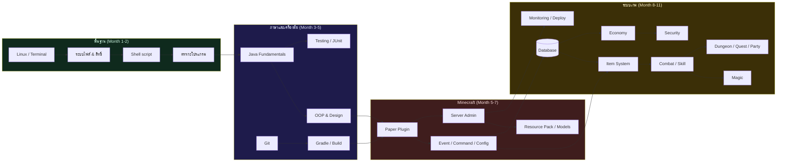
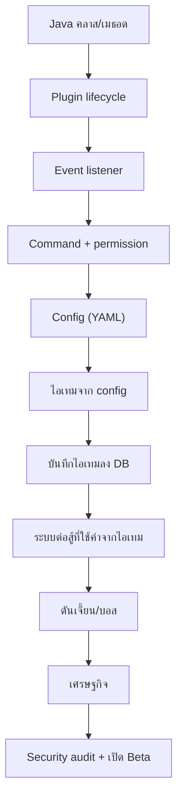

# KNOWLEDGE-MAP.md — แผนที่ความรู้

> 🧠 เอกสารนี้ตอบคำถามว่า **"ทักษะไหนต้องมาก่อน และทักษะไหนต่อยอดจากอะไร"**
> ใช้เมื่อสับสนว่าตอนนี้ควรเรียนอะไร หรือเมื่อเจอปัญหาที่ต้องใช้ความรู้หลายด้านพร้อมกัน

---

## 1. แผนที่หลัก (เส้นทางการพึ่งพาความรู้)

**อ่านแผนที่นี้อย่างไร:** ลูกศรหมายถึง "ต้องมีก่อน" เช่น `Paper Plugin → Event/Command` แปลว่า
ถ้ายังไม่เข้าใจวงจรชีวิตของปลั๊กอิน จะเขียน event ให้ทำงานถูกต้องไม่ได้

---

## 2. แต่ละสาขาเชื่อมกับโปรเจกต์จริงอย่างไร

| ความรู้ | ใช้ในโปรเจกต์ตรงไหน | ตัวอย่างงานจริง |
| --- | --- | --- |
| Linux / Terminal | รันเซิร์ฟเวอร์, ดู log, backup | `./gradlew build`, `tail -f logs/latest.log` |
| Shell script | ระบบเปิด-ปิด-สำรองเซิร์ฟเวอร์ | `scripts/server-start.sh`, `scripts/backup.sh` |
| ตรรกะโปรแกรม | สูตรดาเมจ, ตารางดรอป, เงื่อนไขเควส | `if (roll <= dropChance)` |
| Java | ทุกอย่างในปลั๊กอิน | คลาส `EclipseCore`, `PlayerProfile` |
| OOP & Design | แยกระบบให้ขยายได้ | `interface Skill`, `Registry<Item>` |
| Testing | กันบั๊กกลับมา | `DamageCalculatorTest` |
| Git | ย้อนดูว่าเมื่อไรพัง, ทำงานหลายสาขา | `git log`, `git revert` |
| Gradle | คอมไพล์ + แพ็ก `.jar` | `./gradlew shadowJar` |
| Paper Plugin | ตัวปลั๊กอินเอง | `plugin.yml`, `onEnable()` |
| Event/Command/Config | ทุกปฏิสัมพันธ์กับผู้เล่น | `PlayerJoinEvent`, `/eclipse stats` |
| Server Admin | ดูแลเซิร์ฟเวอร์จริง | `server.properties`, whitelist |
| Resource Pack | หน้าตาเกม | texture ไอเทม, HUD |
| Database | ข้อมูลไม่หาย | ตาราง `player_profile`, `player_item` |
| Item System | ไอเทม/อุปกรณ์ | rarity, affix, upgrade |
| Combat/Skill | ความสนุกหลักของเกม | cooldown, status effect |
| Magic | ความลึกเชิงกลยุทธ์ | ธาตุ + elemental reaction |
| Dungeon/Quest | เป้าหมายให้เล่นต่อ | เควส, บอส, รางวัล |
| Economy | ระบบเงินและตลาด | auction house, transaction |
| Security | กันการโกง/ Abuse | anti-dupe, permission check |
| Ops | เปิดบริการได้จริง | backup, monitoring, runbook |

---

## 3. ลำดับที่ห้ามสลับ (Hard dependencies)

> ⚠️ ถ้าเจอปัญหาที่ Month 9 แต่พื้นฐาน Month 4 ยังไม่แน่น (เช่นไม่เข้าใจ interface)
> ให้ **ถอยไปทบทวน Month 4 ก่อน 1–2 วัน** — เร็วกว่าไล่แก้บั๊กที่เกิดจากความเข้าใจไม่พอ

---

## 4. แผนที่แบบ "สิ่งที่ต้องทำได้" (Skill Tree)

| ระดับ | ชื่อ | ทำอะไรได้ | ผ่านเมื่อ |
| --- | --- | --- | --- |
| 0 | Explorer | เปิด Terminal, หาไฟล์เป็น, รันคำสั่งพื้นฐานได้ | Day 30 |
| 1 | Script Writer | เขียน script ที่รับ input และทำงานซ้ำได้ | Day 30 |
| 2 | Programmer | เขียนลูป/เงื่อนไข/ฟังก์ชันแก้ปัญหาได้ | Day 60 |
| 3 | Java Beginner | เขียนคลาสและคอมไพล์ด้วย Gradle ได้ | Day 90 |
| 4 | Java Developer | ออกแบบคลาส, เขียนเทสต์, ใช้ collection ถูกงาน | Day 120 |
| 5 | Plugin Developer | เขียนปลั๊กอินที่มี event/command/config ได้ | Day 180 |
| 6 | Server Operator | ติดตั้ง+ดูแลเซิร์ฟเวอร์+กู้คืนข้อมูลได้ | Day 210 |
| 7 | Systems Developer | ระบบข้อมูล/ไอเทม/ต่อสู้ที่ทดสอบได้ | Day 240 |
| 8 | Game Systems Designer | ออกแบบและปรับสมดุลระบบเกมด้วยข้อมูล | Day 300 |
| 9 | MMO Operator | เปิด Beta, ดูแลผู้เล่น, วางแผนธุรกิจอย่างมีความรับผิดชอบ | Day 365 |

---

## 5. หัวข้อที่ "ดูเหมือนข้ามได้" แต่ไม่ควรข้าม

| หัวข้อ | ถ้าข้ามจะเป็นอย่างไร |
| --- | --- |
| สิทธิ์ไฟล์ (`chmod`) | script รันไม่ได้ หรือแก้ไฟล์ระบบจนพัง |
| `PATH` | คำสั่ง `java`/`gradle` ใช้ไม่ได้ ทั้งที่ติดตั้งแล้ว |
| Exception handling | ปลั๊กอินล่มทั้งเซิร์ฟเวอร์เพราะข้อมูลผิด 1 แถว |
| Transaction (DB) | เงิน/ไอเทมงอกหรือหายแบบสุ่ม หาสาเหตุไม่ได้ |
| Logging | หาสาเหตุ crash ไม่ได้เลย เพราะไม่มีข้อมูล |
| Backup + Restore test | คิดว่ามี backup แต่กู้คืนไม่ได้ตอนจำเป็น |
| Permission | ผู้เล่นธรรมดาใช้คำสั่งแอดมินได้ → หายนะ |
