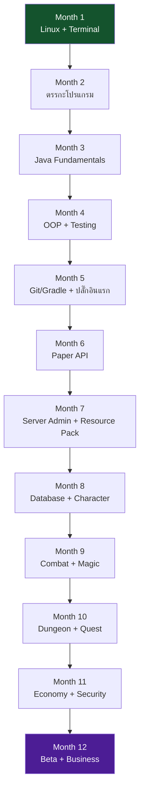

# ROADMAP.md — แผนที่ 12 เดือน (365 วัน)

> 🎯 เอกสารนี้ตอบคำถามว่า **"เดือนนี้ต้องจบอะไร และต้องผ่านเกณฑ์อะไรก่อนไปเดือนถัดไป"**
> ตารางรายวันอยู่ใน [curriculum/365-DAY-PLAN.md](curriculum/365-DAY-PLAN.md)

---

## 1. ภาพรวมเส้นทาง

**ทำไมเรียงแบบนี้?** เพราะแต่ละเดือนใช้ของจากเดือนก่อนเป็นฐาน เช่น
Month 5 (ปลั๊กอินแรก) ต้องใช้ Java จาก Month 3–4 และ Terminal/Git จาก Month 1
ถ้าข้าม Month 3 ไป Month 5 จะเจอ error ที่อ่านไม่ออกทันที

---

## 2. ตารางสรุปรายเดือน

| # | เดือน | Day | เรียนอะไร (สรุป) | โปรเจกต์/ผลงาน | เกณฑ์ผ่านก่อนขึ้นเดือนถัดไป |
| --- | --- | --- | --- | --- | --- |
| 1 | Linux & Tools | 001–030 | Terminal, ไฟล์, สิทธิ์, script, log, backup, Git, editor, JDK | `projects/01-linux-lab` (script 4 ไฟล์) | รัน script ได้เองทุกไฟล์ + อธิบาย `|`, `>`, `chmod`, `PATH` ได้ |
| 2 | Programming Logic | 031–060 | ตัวแปร, เงื่อนไข, ลูป, ฟังก์ชัน, JSON/YAML, ความน่าจะเป็น, state machine | `projects/02-programming-lab` | เขียนลูป/เงื่อนไขเองได้โดยไม่ดูตัวอย่าง + อ่านค่า config YAML ได้ |
| 3 | Java Fundamentals | 061–090 | JDK 25, คอมไพล์/รัน, ชนิดข้อมูล, เมธอด, คลาส, collection เบื้องต้น | `projects/03-java-lab` | เขียนคลาสง่าย ๆ เองได้ + แก้ error คอมไพล์เองได้ |
| 4 | OOP & Testing | 091–120 | Inheritance, interface, generics, lambda, stream, exception, JUnit | `projects/03-java-lab` (เวอร์ชัน OOP + tests) | อธิบายได้ว่าทำไมใช้ interface + เขียนเทสต์ให้สูตรคำนวณได้ |
| 5 | Git & First Plugin | 121–150 | branch/merge, Gradle, Maven, debugger, plugin lifecycle | `projects/04-first-plugin` (v1) | สร้าง `.jar` และติดตั้งบนเซิร์ฟเวอร์ได้จริง |
| 6 | Paper API | 151–180 | Event, command, permission, config, GUI, Adventure | `projects/05-paper-server` + plugin v2 | เขียน event + command ใหม่เองได้โดยเปิด Javadoc เอง |
| 7 | Server Admin & Pack | 181–210 | Paper 26.3, server.properties, plugin mgmt, backup, resource pack, Blockbench | เซิร์ฟเวอร์ทดสอบ + pack ของตัวเอง | เพื่อนเข้าเล่นได้ + กู้คืนจาก backup ได้จริง |
| 8 | Data & Progression | 211–240 | SQL, JDBC, HikariCP, migration, Item Registry, rarity, affix, level | Character System v1 | รีสตาร์ทแล้วข้อมูลไม่หาย + ไม่มี SQL injection |
| 9 | Combat & Magic | 241–270 | Damage engine, cooldown, status effect, skill registry, mana, elements | Combat/Magic v1 | มี unit test ของสูตรดาเมจ + ทดสอบเล่นจริงแล้ว |
| 10 | Content Systems | 271–300 | mob AI, boss phase, dungeon, quest, NPC, party, guild, jobs | Dungeon + Quest + Party | เล่นดันเจี้ยนจบรอบได้กับ 2–4 คน |
| 11 | Economy & Ops | 301–330 | money faucet/sink, transaction, auction, dupe test, web, monitoring | Economy + Security Audit + เว็บ | ทดสอบ dupe 3 สถานการณ์ + มี monitoring ทำงาน |
| 12 | Beta & Business | 331–365 | Dev/Staging/Prod, deploy, runbook, beta, retention, pricing, law | เซิร์ฟเวอร์พร้อมเปิด + แผนธุรกิจ | เปิด Beta ได้ + รู้จุดคุ้มทุนจากตัวเลขจริง |

---

## 3. จังหวะของทุกเดือน (โครงสร้างเดียวกันทุกเดือน)

| วันที่ | กิจกรรม | หมายเหตุ |
| --- | --- | --- |
| 1–6 | เรียนเนื้อหาใหม่ (วันละหัวข้อ) | ต้องมีผลงานทุกวัน |
| **7** | 🔁 REVIEW สัปดาห์ | ทบทวน + คะแนน + commit |
| 8–13 | เนื้อหาใหม่ | ต่อยอดจากสัปดาห์แรก |
| **14** | 🔁 REVIEW | |
| **15** | 😴 REST | พักตามแผน ไม่มีงานส่ง |
| 16–20 | เนื้อหาใหม่ | |
| **21** | 🔁 REVIEW | |
| 22–27 | เนื้อหาใหม่ | |
| **28** | 🔁 REVIEW | |
| 29–30 | 🏁 โปรเจกต์ประจำเดือน + ประเมิน | ต้องผ่านเกณฑ์ก่อนขึ้นเดือนถัดไป |

> ⏳ ถ้าเรียนไม่ทัน: **เลื่อนวัน** ไม่ใช่ตัดวันทบทวน และลดขนาดโปรเจกต์ (ไม่ลดคุณภาพการทดสอบ)

---

## 4. เกณฑ์ประเมิน (ใช้ทุกสัปดาห์และทุกเดือน)

คะแนน 1–5 ต่อหัวข้อ: `1 = ยังไม่เข้าใจ` · `3 = ทำตามได้` · `5 = อธิบายให้คนอื่นได้และดัดแปลงเองได้`

| ด้าน | ต้องได้ ≥3 ก่อนขึ้นเดือนถัดไป |
| --- | --- |
| อธิบายแนวคิด | พูดอธิบายด้วยคำตัวเองได้ โดยไม่เปิดเอกสาร |
| เขียนโค้ด | เขียน/แก้โค้ดที่ไม่เคยเห็นมาก่อนได้ (เล็ก ๆ) |
| ทดสอบ | รันคำสั่งทดสอบเองและอ่านผลเป็น |
| แก้ error | ระบุสาเหตุจากข้อความ error ได้อย่างน้อย 1 ใน 2 เคส |
| ความถูกต้องของงาน | ผ่าน checklist ใน [tests/](tests/) |

**ถ้าไม่ผ่าน**: ทำบทเรียนทบทวนเฉพาะจุดที่พลาด (ครูจะเขียนให้ใหม่) ไม่ใช่ทำข้อสอบเดิมซ้ำ

---

## 5. ความเสี่ยงที่รู้ล่วงหน้า (และแผนรับมือ)

| ความเสี่ยง | ผลกระทบ | แผนรับมือ |
| --- | --- | --- |
| กล้อง Isometric ทำไม่ได้บน Vanilla client | ต้องเปลี่ยนดีไซน์เกม | ทดลองตั้งแต่ Month 7 (Day 207) และ Month 9 (Day 269) — บันทึกข้อจำกัดจริงไว้ที่ `docs/camera-limits.md` |
| Plugin MMO สำเร็จรูปปิด source/ไม่รองรับ 26.3 | ต้องเขียนเอง | หลักสูตรบังคับให้เขียนระบบหลักเองเป็นค่าเริ่มต้น (ใช้ plugin สำเร็จรูปเฉพาะส่วนที่ไม่มีมูลค่าเรียนรู้) |
| เวอร์ชัน Minecraft เปลี่ยนกลางคัน | ปลั๊กอินพัง | ตรึงเวอร์ชัน Paper ที่ใช้ + ทดสอบบน Staging ก่อนเสมอ (Month 12) |
| ข้อมูลผู้เล่นหาย | เสียผู้เล่นทันที | Backup + Restore test ใน Month 7 และ Month 12 (ต้องกู้คืนได้จริง ไม่ใช่แค่มีไฟล์) |
| ค่าใช้จ่ายเกินรายได้ | ปิดเซิร์ฟเวอร์ | คำนวณต้นทุนจริงใน [business/operating-costs.md](business/operating-costs.md) ก่อนเปิดรับผู้เล่น |
| เรียนช้าลงเมื่อถึง Month 9–10 | ท้อ | แบ่งงานใหญ่เป็นชิ้นเล็ก + ลดขอบเขตเนื้อหาเกม ไม่ลดพื้นฐานเทคนิค |

---

## 6. สิ่งที่ต้อง "อธิบายกลับได้" ก่อนขยายระบบ

ตามกฎของหลักสูตร ระบบสำคัญ 4 ตัวนี้ **ห้ามขยายต่อ** จนกว่าจะอธิบายแนวคิดกลับได้:

1. **Damage Engine** — ลำดับการคำนวณและตัวคูณทั้งหมด (Month 9)
2. **Inventory/Item Persistence** — ข้อมูลไอเทมเก็บที่ไหนและทำไมไม่หาย (Month 8)
3. **Economy** — เงินเข้าจากไหน ออกทางไหน และทำไมทำรายการซ้ำไม่ได้ (Month 11)
4. **Security** — อะไรเช็กที่เซิร์ฟเวอร์ อะไรเช็กที่ไคลเอนต์ และทำไม (Month 11)

---

## 7. หลัง Day 365

เมื่อจบหลักสูตรแล้ว เส้นทางต่อที่แนะนำ (เรียงตามความคุ้มค่า):

1. เปิด Beta ต่อเนื่องและแก้ปัญหาจากข้อมูลจริง 4–8 สัปดาห์
2. เพิ่มเนื้อหา (ดันเจี้ยน/คลาส/เควส) ตาม retention ที่วัดได้
3. ทำระบบหลังบ้าน (เว็บ/discord bot) ให้ลดภาระแอดมิน
4. พิจารณาเปิดขายของในเกมเมื่อสมดุลเกมนิ่งแล้ว (อ่าน [business/monetization.md](business/monetization.md))
5. ถ้าจะขยายเป็นหลายเซิร์ฟเวอร์: แยก proxy (Velocity) + ฐานข้อมูลกลาง (ยังไม่ต้องเรียนใน 365 วันนี้)
