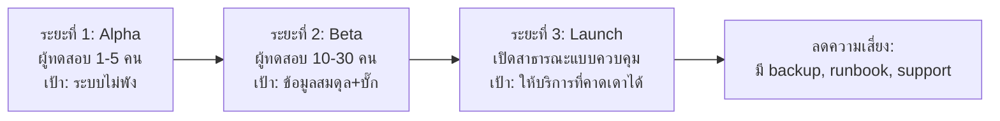

# business-plan.md — แผนธุรกิจเซิร์ฟเวอร์ Minecraft MMO RPG

> ⚠️ **อ่านก่อน:** เอกสารนี้เป็น *กรอบการคิด* ไม่ใช่คำสัญญาว่าจะทำกำไร
> หลักสูตรนี้ **ไม่รับประกัน** ว่าเซิร์ฟเวอร์จะได้กำไรภายในหนึ่งปี
> การทำธุรกิจต้องเริ่มจาก **ต้นทุนจริงและความเสี่ยงจริง** ไม่ใช่จำนวนผู้เล่นในฝัน
> ตัวเลขทุกตัวในเอกสารธุรกิจชุดนี้ต้องถูกแทนที่ด้วยข้อมูลจริงของคุณก่อนใช้ตัดสินใจ

---

## 1. เป้าหมายและหลักการ 7 ข้อ

1. **ผู้เล่นต้องสนุกก่อน** — ถ้าเกมไม่สนุก การตลาดไม่ช่วยอะไร
2. **ไม่ขายความได้เปรียบ** — ขายของที่ไม่ทำให้ผู้เล่นใหม่เสียเปรียบ
3. **อธิบายให้ชัด** — สิทธิ์ของสินค้า ระยะเวลา และข้อจำกัด ต้องบอกก่อนจ่ายเงิน
   (ห้ามใช้คำโฆษณาเกินจริง และห้ามคิดว่าผู้เล่นจะเข้าใจเอง)
4. **เก็บข้อมูลเท่าที่จำเป็น** — ยิ่งเก็บมาก ยิ่งมีความรับผิดชอบมาก
5. **มีช่องทางติดต่อที่ตอบได้จริง** — ถ้าตอบไม่ได้ อย่าเริ่มรับเงิน
6. **ทำตามกฎของ Mojang** — Minecraft Commercial Usage Guidelines และ EULA
7. **ทดลองเล็กก่อนขยาย** — เปิดกับกลุ่มเล็กก่อนลงทุนเยอะ

---

## 2. วิเคราะห์กลุ่มผู้เล่น (ทำเป็นข้อ ๆ ให้ครบก่อนออกแบบเกม)

| หัวข้อ | คำถามที่ต้องตอบ |
| --- | --- |
| ใคร | ช่วงอายุ, ประเทศ/ภาษา, เล่น Minecraft อยู่แล้วหรือเป็นผู้เล่นใหม่ |
| ทำไมเขาจะเล่น | เขากำลังหายอะไรอยู่ (เนื้อหาจบเร็ว? เพื่อนเล่น? ชอบลงดันเจี้ยน?) |
| เขาเล่นเมื่อไร | เวลาว่าง/ช่วงเวลา — มีผลต่อการจัดกิจกรรม |
| เขาชอบอะไร | แนวทางเล่น, ความยากที่พอดี, ระบบสังคม |
| เขาอยู่ทั่วไปที่ไหน | Discord, TikTok, YouTube, กลุ่ม Facebook, Pantip, โรงเรียน |
| เขาจ่ายเงินไหม | เคยจ่ายในเกมไหม, จ่ายเพราะอะไร, งบประมาณต่อเดือน |

> 💡 แบบฝึกหัด Month 12: สัมภาษณ์ผู้เล่น 5 คนจริง แล้วเขียนสรุป 1 หน้า — ตัวเลขควรมาจากตรงนี้ ไม่ใช่จากการเดา

---

## 3. เอกลักษณ์ของเกม (USP)

ต้องตอบให้ได้ใน 1 ประโยค: **"ทำไมต้องเล่นเซิร์ฟเวอร์เรา ไม่ใช่เล่นเซิร์ฟเวอร์อื่น"**

ตัวอย่างกรอบ USP (เลือก 1–2 ข้อ ไม่ใช่ทุกข้อ เพื่อไม่ให้ทำไม่ทัน):

| แนวทาง | อธิบาย | ต้องลงทุนอะไร |
| --- | --- | --- |
| เนื้อหา PvE ลึก (ดันเจี้ยน/บอส/กลไก) | เกมมีเป้าหมายให้เล่นเป็นรอบ | งานออกแบบ+เขียนระบบเยอะ |
| ระบบคลาส/สกิลเฉพาะตัว | ตัวละครต่างกันจริง เล่นได้หลายแบบ | ปรับสมดุลยาก ต้องมีเทสต์ |
| ระบบอาชีพ/เศรษฐกิจ | ผู้เล่นมีเป้าหมายระยะยาวแบบไม่ต่อสู้ | ต้องออกแบบเศรษฐกิจดีมาก |
| ชุมชนเล็กที่อบอุ่น | บรรยากาศเป็นมิตร ผู้เล่นใหม่มีคนช่วย | ต้องใช้เวลาแอดมินจริง |
| เนื้อหาไทย/วัฒนธรรมไทย | เข้าถึงกลุ่มไทยได้ง่าย | ต้องออกแบบเนื้อหาเองทั้งหมด |

⚠️ การทำทุกข้อพร้อมกันเป็นสาเหตุอันดับหนึ่งที่เซิร์ฟเวอร์ indie ไม่เสร็จ

---

## 4. แผนเนื้อหา (High-level, 6 เดือนแรก)

| เดือน | เนื้อหาหลัก | เหตุผล |
| --- | --- | --- |
| 1 | ระบบพื้นฐานครบ + เนื้อหาเล่นซ้ำได้ 1 ลูป | ผู้เล่นต้องมีอะไรทำทันทีที่เข้า |
| 2 | ดันเจี้ยน 2–3 แห่ง + บอส | เพิ่มความท้าทาย |
| 3 | ระบบสังคม (ปาร์ตี้/กิลด์/ตลาด) | ให้ผู้เล่นกลับมาเพราะเพื่อน |
| 4 | เนื้อหาระดับสูง (คลาสใหม่/ธาตุใหม่) | รักษาผู้เล่นระยะกลาง |
| 5 | อีเวนต์ตามเทศกาล + ระบบแข่งขัน | สร้างกระแสเป็นช่วง |
| 6 | ทบทวนสมดุล + ระบบสำหรับผู้เล่นใหม่ | ลดการหลุดของผู้เล่นใหม่ |

---

## 5. แผน 3 ระยะ

| ระยะ | เงื่อนไขผ่าน | ห้ามทำ |
| --- | --- | --- |
| Alpha | ระบบพื้นฐานทำงาน, ไม่มีบั๊กข้อมูลระดับร้ายแรง | ยังไม่รับเงิน |
| Beta | ข้อมูลไม่หาย, TPS ≥ 19 กับผู้ทดสอบ 10–30 คน | ยังไม่ขายของที่กระทบสมดุล |
| Launch | runbook + backup/restore ทดสอบผ่าน + มีช่องทางซัพพอร์ต | อย่าประกาศก่อนพร้อม |

---

## 6. ตัวชี้วัดที่ต้องวัดจริง (ไม่ใช่ความรู้สึก)

| ตัวชี้วัด | นิยาม | เก็บอย่างไรมือใหม่ |
| --- | --- | --- |
| DAU | ผู้เล่นเล่นในวันหนึ่ง | นับจาก log การเข้า/ออก (ไม่ใช้ plugin หนัก) |
| Retention D1/D7/D30 | % ผู้เล่นกลับมาเล่นในวันที่ 1/7/30 | เก็บวันที่เข้าเล่นครั้งแรก + ครั้งถัดไป |
| Session length | เวลาเล่นต่อครั้ง | เวลาออก − เวลาเข้า |
| Conversion | % ผู้เล่นที่จ่ายเงิน | นับจากรายการสั่งซื้อจริง |
| ARPPU | รายได้เฉลี่ยต่อผู้จ่าย 1 คน | รายได้ ÷ จำนวนผู้จ่าย |
| Churn | ผู้เล่นที่เลิกเล่น | ผู้ที่ไม่กลับมาภายใน 14 วัน |
| Support load | จำนวนคำร้องต่อสัปดาห์ | บันทึกทุกครั้ง |

> 📌 ก่อน Month 12 ยังไม่จำเป็นต้องมีตัวเลขเหล่านี้ แต่ควรออกแบบให้เก็บได้ตั้งแต่วันแรกที่เปิดให้คนเล่น

---

## 7. โครงสร้างบทบาท (แม้ทำคนเดียว)

| บทบาท | งานหลัก | ทำคนเดียวอย่างไร |
| --- | --- | --- |
| Game Designer | ออกแบบระบบ/สมดุล | ทำเอง (เป็นบทบาทหลักของคุณ) |
| Developer | เขียนปลั๊กอิน | ทำเอง (หลักสูตรนี้) |
| Operator | ดูแลเซิร์ฟเวอร์/แบ็กอัป | ทำเอง + ใช้ script อัตโนมัติ |
| Community Manager | Discord/โซเชียล | ทำเองก่อน แล้วหา mod อาสา |
| Support | ตอบผู้เล่น | ตั้งช่องทางเดียว + เวลาตอบที่ชัดเจน |
| Marketing | หาผู้เล่น | อาศัยคลิปผู้เล่น/ครีเอเตอร์ + ชุมชน |

> ⚠️ ถ้าคนเดียวรับทุกบทบาท ให้ **ลดขอบเขตเกม** อย่าลดคุณภาพของ backup/security

---

## 8. ความเสี่ยงและแผนรับมือ

| ความเสี่ยง | โอกาส | ผลกระทบ | แผนรับมือ |
| --- | --- | --- | --- |
| ผู้เล่นไม่สนใจ (ไม่มีคนเล่น) | สูง | สูง | เปิด Beta กับกลุ่มเล็กก่อน + วัด retention ก่อนลงทุน |
| ข้อมูลผู้เล่นหาย | กลาง | สูงมาก | backup + ทดสอบ restore ทุกเดือน |
| ถูกโจมตี/ปลั๊กอินมีช่องโหว่ | กลาง | สูง | อัปเดตสม่ำเสมอ, whitelist ช่วงแรก, จำกัดสิทธิ์ |
| ต้นทุนสูงกว่ารายได้ | สูง | สูง | เริ่มจากผู้ให้บริการราคาต่ำ + คำนวณต้นทุนก่อนเปิด |
| บั๊กเศรษฐกิจ/of ของงอก | กลาง | สูง | ทดสอบ dupe ก่อนและหลังทุกการเปลี่ยนแปลง |
| ทะเลาะในชุมชน | กลาง | กลาง | กฎชัด + moderation + ช่องทางร้องเรียน |
| ถูกอ้างเรื่องกฎหมาย/ลิขสิทธิ์ | ต่ำ | สูง | ทำตาม guidelines, ไม่ใช้ asset ที่ไม่มีสิทธิ์, เก็บข้อมูลเท่าที่จำเป็น |

---

## 9. จริยธรรมและความรับผิดชอบ

- **ห้ามขายกล่องสุ่มที่ต้องจ่ายเงินเพื่อลุ้น** *(loot box)* — เป็นประเด็นทางกฎหมายในหลายประเทศและทำให้ผู้เล่นเสียความเชื่อใจ
- **ห้ามโฆษณาเกินจริง** — อย่าบอกว่า "แรงที่สุดในเซิร์ฟเวอร์" ถ้าไม่จริง
- **บอกระยะเวลาสินค้าให้ชัด** — ถ้าสินค้าหมดอายุ ต้องบอกก่อนซื้อ
- **ผู้เล่นใหม่ต้องเล่นได้** — ของที่ขายไม่ควรทำให้ผู้เล่นใหม่เล่นไม่ได้เลย
- **ข้อมูลผู้เล่น** — เก็บเท่าที่จำเป็น, บอกว่าเก็บอะไร, และลบให้ได้ถ้าผู้เล่นขอ
- **เด็กและเยาวชน** — ถ้ากลุ่มเป้าหมายอายุน้อย ต้องระวังการกระตุ้นให้ใช้จ่าย

---

## 10. สิ่งที่ต้องตรวจสอบก่อนเปิดขาย (ทำเป็น checklist)

- [ ] อ่าน [Minecraft Commercial Usage Guidelines](https://www.minecraft.net/en-us/usage-guidelines) และ [EULA](https://www.minecraft.net/en-us/eula) แล้วสรุปข้อห้ามที่เกี่ยวกับเรา
- [ ] ตรวจเงื่อนไขของผู้ให้บริการรับชำระเงิน (ค่าธรรมเนียม, การคืนเงิน, ข้อจำกัดธุรกิจ)
- [ ] ตรวจภาษี/การจดทะเบียนที่เกี่ยวข้อกับรายได้ (ปรึกษาผู้รู้เรื่องบัญชี/ภาษีในพื้นที่ของคุณ)
- [ ] ตรวจ PDPA/GDPR เบื้องต้น: เก็บข้อมูลอะไร เก็บที่ไหน ลบได้ไหม
- [ ] เขียนนโยบาย: กฎเซิร์ฟเวอร์, การคืนเงิน, ความเป็นส่วนตัว
- [ ] เปิดช่องทางซัพพอร์ตที่ตอบได้จริง + ระบุเวลาตอบกลับ

> 📌 ลิงก์และเงื่อนไขเหล่านี้อาจเปลี่ยนได้ — ต้องเปิดตรวจด้วยตัวเองทุกครั้งก่อนตัดสินใจขายของ
