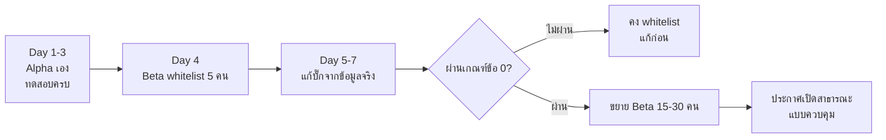

# launch-checklist.md — Checklist ก่อนเปิดให้บริการ

> 🚀 ใช้ checklist นี้ **ก่อนเปิด Beta** และ **ก่อนเปิดสาธารณะ**
> กฎ: ถ้าข้อไหนยังไม่ได้ทดสอบจริง ให้ทำเครื่องหมาย ☐ ไว้ และห้ามประกาศวันเปิด

---

## 0. เกณฑ์ "พร้อมเปิด" (ต้องผ่านครบก่อนขยับไปข้ออื่น)

- [ ] เซิร์ฟเวอร์รันต่อเนื่อง 7 วันโดยไม่ crash (หรืออธิบายสาเหตุ crash ได้และแก้แล้ว)
- [ ] Backup + **Restore ทดสอบแล้ว** อย่างน้อย 1 ครั้ง (มีบันทึกเวลา)
- [ ] ข้อมูลผู้เล่นไม่หายเมื่อรันเซิร์ฟเวอร์ใหม่ (ผ่าน checklist [data-persistence](../tests/checklists/data-persistence.md))
- [ ] TPS ≥ 19 เมื่อมีผู้เล่นจำนวนเป้าหมายของ Beta
- [ ] มีผู้ช่วย 1 คนหรือมีช่องทางติดต่อชั่วคราวสำหรับช่วงเปิด

---

## 1. ด้านเทคนิค (Technical)

| # | รายการ | หลักฐานที่ต้องมี | ผ่าน? |
| --- | --- | --- | --- |
| 1 | เวอร์ชัน Paper เป็นรุ่น STABLE และจดไว้ | หมายเลข build | ☐ |
| 2 | Java ตรงกับที่เอกสารกำหนด (Java 25 สำหรับ Paper 26.x) | `java -version` | ☐ |
| 3 | ปลั๊กอินทุกตัวจดไว้ในตาราง (ชื่อ เวอร์ชัน เหตุผล ผู้พัฒนา) | `docs/plugins.md` | ☐ |
| 4 | ไม่มีปลั๊กอินที่ไม่ได้ใช้หรือไม่มีคนดูแล | ตารางเดียวกัน | ☐ |
| 5 | Whitelist เปิดในช่วงBeta | `whitelist.json` | ☐ |
| 6 | `online-mode` ตั้งค่าตามที่ออกแบบ | `server.properties` | ☐ |
| 7 | Port เปิดเฉพาะที่จำเป็น; RCON ปิดหรือจำกัด | `ss -tulpn` | ☐ |
| 8 | Firewall ตั้งค่าถูกต้อง | ผลตรวจ | ☐ |
| 9 | ตั้ง RAM/JVM ให้เหมาะสม | `start.sh` | ☐ |
| 10 | มีระบบแจ้งเตือนเมื่อเซิร์ฟเวอร์ล่ม/TPS ตก | หลักฐานการแจ้งเตือน | ☐ |

---

## 2. ด้านข้อมูลและความปลอดภัย (Data & Security)

| # | รายการ | หลักฐาน | ผ่าน? |
| --- | --- | --- | --- |
| 11 | Backup อัตโนมัติทุกวัน เก็บนอกเครื่อง | ที่เก็บ + ตารางเวลา | ☐ |
| 12 | Restore ทดสอบแล้ว + จับเวลาได้ | บันทึกผล | ☐ |
| 13 | ไม่มีรหัสผ่าน/คีย์ใน Git หรือในไฟล์ที่ผู้เล่นเข้าถึงได้ | `git log -p` ตรวจแล้ว | ☐ |
| 14 | สิทธิ์แอดมินจำกัดเฉพาะคนที่ต้องใช้ | กลุ่มใน LuckPerms | ☐ |
| 15 | บัญชีแอดมินไม่ใช้ร่วมกัน และเปิด 2 ชั้นถ้าทำได้ | นโยบาย | ☐ |
| 16 | มี log การใช้คำสั่งแอดมิน | ปลั๊กอิน/ไฟล์ log | ☐ |
| 17 | ทดสอบช่องโหว่พื้นฐาน: กดรัว, ออกกลางคัน, รีสตาร์ทกลางรายการ | บันทึกผล | ☐ |
| 18 | รู้ว่าข้อมูลผู้เล่นอะไรถูกเก็บ และเก็บทำไม | นโยบายความเป็นส่วนตัว | ☐ |
| 19 | ลบข้อมูลผู้เล่นตามคำขอได้ (ถ้าถูกขอ) | ขั้นตอน | ☐ |

---

## 3. ด้านกฎและเอกสาร (Legal & Policy)

| # | รายการ | ผ่าน? |
| --- | --- | --- |
| 20 | อ่าน Minecraft EULA + Commercial Usage Guidelines แล้วสรุปข้อที่เกี่ยวข้อง | ☐ |
| 21 | ไม่ใช้ asset (ภาพ/เสียง/โมเดล) ที่ไม่มีสิทธิ์ใช้ | ☐ |
| 22 | มีนโยบายความเป็นส่วนตัว (เก็บอะไร ทำไม ลบได้ไหม) | ☐ |
| 23 | มีนโยบายคืนเงิน (ถ้ามีการรับเงิน) | ☐ |
| 24 | มีกฎเซิร์ฟเวอร์ที่ผู้เล่นอ่านได้ชัดเจน | ☐ |
| 25 | ตรวจภาษี/การจดทะเบียนที่เกี่ยวข้องกับรายได้ | ☐ |
| 26 | ตรวจเงื่อนไขของผู้ให้บริการรับชำระเงิน | ☐ |

---

## 4. ด้านผู้เล่นและชุมชน (Community & Support)

| # | รายการ | ผ่าน? |
| --- | --- | --- |
| 27 | มีช่องทางติดต่อเดียว (Discord/เว็บ) และเวลาตอบกลับที่ระบุไว้ | ☐ |
| 28 | มีแบบฟอร์มรายงานบั๊ก (อะไร ทำเมื่อไร ผลเป็นอย่างไร เวอร์ชัน) | ☐ |
| 29 | มีกฎ Discord + ขั้นตอน moderation | ☐ |
| 30 | มีผู้ดูแลอย่างน้อย 2 คน (หรือมีเวลาออนไลน์ที่ประกาศไว้) | ☐ |
| 31 | มีนโยบายรับมือข้อร้องเรียน (ตอบภายในกี่ชั่วโมง ใครตัดสิน) | ☐ |
| 32 | ผู้เล่นใหม่มีคู่มือเริ่มเล่น (สั้น อ่าน 2 นาทีเข้าใจ) | ☐ |

---

## 5. ด้านการเงิน (Financial)

| # | รายการ | ผ่าน? |
| --- | --- | --- |
| 33 | รู้ต้นทุนต่อเดือนจริง (ไม่ใช่ประมาณ) | ☐ |
| 34 | รู้จุดคุ้มทุนจากตัวเลขจริง | ☐ |
| 35 | มีเงินสำรองอย่างน้อย 3 เดือนของต้นทุนเซิร์ฟเวอร์ | ☐ |
| 36 | ทดสอบขั้นตอนรับเงิน→ให้ของ→ตรวจ log ครบวงจร | ☐ |
| 37 | มีขั้นตอนคืนเงินที่ทดลองแล้ว | ☐ |

---

## 6. ด้านการตลาด (Marketing)

| # | รายการ | ผ่าน? |
| --- | --- | --- |
| 38 | มีคลิป/ภาพสั้นที่อธิบายว่าเกมสนุกตรงไหน | ☐ |
| 39 | มีหน้าเว็บ/โพสต์ที่บอกรายละเอียดเซิร์ฟเวอร์ + IP | ☐ |
| 40 | ตั้งเป้าผู้เล่น Beta ชัดเจน (เช่น 15 คน ไม่ใช่ 500) | ☐ |
| 41 | แผนวัดผลหลังเปิด (DAU, retention, บั๊กที่พบบ่อย) | ☐ |
| 42 | เตรียมคำตอบคำถามที่พบบ่อย (แครช, เข้าไม่ได้, ของหาย) | ☐ |

---

## 7. แผนเปิดตัว (ทำตามลำดับ ห้ามข้าม)

---

## 8. แผนถอย (Rollback Plan) — ต้องเขียนก่อนเปิด

| สถานการณ์ | สิ่งที่ทำทันที | เกณฑ์ตัดสิน |
| --- | --- | --- |
| TPS ต่ำกว่า 15 ต่อเนื่อง 10 นาที | ปิดระบบ/ปลั๊กอินที่หนักที่สุดชั่วคราว + แจ้งผู้เล่น | ยังไม่หายภายใน 30 นาที → ปิดเซิร์ฟเวอร์ชั่วคราว |
| ข้อมูลผู้เล่นหายบางส่วน | หยุดรับข้อมูลใหม่ + กู้คืนจาก backup | กระทบเกิน 5 ผู้เล่น → แจ้งผู้เล่นตรง ๆ + คืนของ |
| พบช่องโหว่ของงอก | ปิดฟีเจอร์นั้นทันที | หาสาเหตุได้แล้วค่อยเปิด |
| ถูกโจมตี (DDoS/สแปม) | จำกัดการเข้าถึง/เปิด whitelist ชั่วคราว | ต่อเนื่องเกิน 30 นาที → แจ้งผู้ให้บริการ |

> 📌 การซื่อสัตย์กับผู้เล่นตอนมีปัญหา สร้างความเชื่อใจมากกว่าการเงียบ
