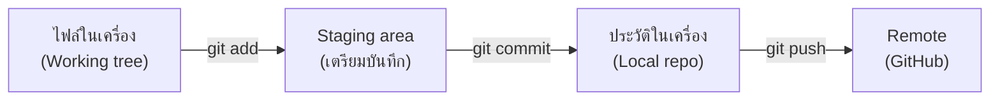

# Day 05 — Git และ Version Control สำหรับโปรเจกต์จริง

> 📅 Month 1 · Week 1 · ~150 นาที · **โหมด: Guided Practice → Independent Practice**

---

## A. เป้าหมาย

จบบทนี้คุณจะ:
- อธิบายได้ว่า **Version Control** แก้ปัญหาอะไร (และทำไมโปรเจกต์เกมจำเป็นต้องมี)
- ใช้ `git init`, `add`, `commit`, `log`, `status`, `diff` ได้เอง
- เขียน `.gitignore` ที่ถูกต้องสำหรับโปรเจกต์ Minecraft/Java
- ส่งงานขึ้น GitHub ได้ (และเข้าใจว่า `.gitignore` กันอะไรไม่ให้หลุดขึ้นไป)
- อธิบายได้ว่า "ทำไมห้าม commit รหัสผ่าน"

**ผลงานที่ต้องได้:** repo ของโปรเจกต์ตัวเองที่มี commit อย่างน้อย 3 ครั้ง + `.gitignore` + ประวัติที่อ่านรู้เรื่อง

---

## B. ความรู้ที่ต้องมี

- Day 01–04: Terminal, ไฟล์, สิทธิ์, JDK พร้อมใช้งาน

---

## C. แนวคิด

### C.1 ปัญหาที่ Git มาแก้

ลองจินตนาการว่าไม่มี Git:

```text
plugin-final.java
plugin-final-v2.java
plugin-final-v2-แก้บั๊ก.java
plugin-final-v2-แก้บั๊ก-จริงๆ.java
plugin-final-ใช้ได้แล้ว-อย่าแตะ.java
```

ใช่ — นี่คือชีวิตจริงของคนที่ไม่มี Git และเมื่อ "เวอร์ชันที่ใช้ได้" หายไป จะกู้คืนไม่ได้เลย

**Git** เก็บ **ประวัติ** ของทุกการเปลี่ยนแปลง พร้อม:
- ใครแก้ (ถ้าทำงานเป็นทีม)
- แก้อะไร (เทียบทีละบรรทัดได้)
- เมื่อไร
- ทำไม (จากข้อความ commit ที่เราเขียน)

เทียบกับเกม: Git เหมือน **ระบบบันทึกการเล่น (save game) แบบหลายสล็อต** ที่ย้อนกลับไปสล็อตไหนก็ได้ โดยไม่ต้องเขียนทับ

### C.2 คำศัพท์สำคัญ 5 คำ

| คำ | ความหมายแบบเข้าใจง่าย | เทียบกับเกม |
| --- | --- | --- |
| **Repository (repo)** | โฟลเดอร์ที่ Git ติดตามอยู่ | เซิร์ฟเวอร์ที่เราสร้างตัวละครไว้ |
| **Commit** | การบันทึกความเปลี่ยนแปลง 1 ครั้งพร้อมข้อความ | การ Save เกม 1 สล็อต |
| **Branch** | สายงานแยกออกมา | การเล่นเซฟแยก (ทดลองโดยไม่กระทบของเดิม) |
| **Remote (origin)** | repo อีกที่หนึ่งบนอินเทอร์เน็ต | เซิร์ฟเวอร์สำรองในระบบ |
| **Working tree** | สถานะไฟล์จริงในเครื่องตอนนี้ (ยังไม่ commit) | ของที่ยังไม่ได้ Save |

### C.3 โฟลว์การทำงานของ Git 3 ขั้น (จำให้ขึ้นใจ)



ทำไมต้องมี staging? เพราะมันให้เรา **เลือกว่าจะบันทึกอะไร** เช่น เราแก้ 5 ไฟล์ แต่จะ commit แค่ 2 ไฟล์ที่เกี่ยวข้องในงานเดียว
→ ทำให้ประวัติอ่านง่ายและย้อนกลับได้แม่น

### C.4 `.gitignore` — กันของที่ไม่ควรขึ้น Git

สำหรับโปรเจกต์ Java/Minecraft ต้องกัน:

| กันอะไร | ทำไม |
| --- | --- |
| `build/`, `target/` | ไฟล์จากการคอมไพล์ (สร้างใหม่ได้เสมอ) |
| `*.jar` (ของปลั๊กอินที่ build ได้) | ไฟล์ binary ไม่ควรอยู่ในประวัติ (ต่างจาก `.jar` ที่ต้องใช้รันเซิร์ฟเวอร์) |
| `logs/`, `*.log` | ไฟล์ log ใหญ่และเปลี่ยนตลอด |
| `world/`, `world_nether/`, `world_the_end/` | ข้อมูลโลกขนาดใหญ่ (เป็น GB) |
| `.env`, `*.env` | ⚠️ ไฟล์ความลับ (รหัสผ่าน DB, API key) |
| `libraries/`, `versions/`, `cache/` | ของที่โปรแกรมสร้างเอง |

> ⚠️ **กฎความปลอดภัยที่ห้ามละเมิด:** ห้าม commit รหัสผ่าน/API key ลง Git ทุกกรณี
> ถ้าเผลอทำแล้ว ต่อให้ลบไฟล์ภายหลัง ประวัติยังเก็บมันไว้ — ต้องเปลี่ยนรหัสทันทีและแจ้งผู้เกี่ยวข้อง

---

## D. ตัวอย่าง

### D.1 ตรวจว่า Git ติดตั้งหรือยัง

```bash
which git
git --version
pacman -Qs git | head -3
```

ถ้ายังไม่มี: `sudo pacman -S git`

### D.2 ตั้งค่าตัวตน (สำคัญ — commit ทุกครั้งจะฝังชื่อนี้ไว้)

```bash
git config --global user.name "ชื่อที่ต้องการให้แสดง"
git config --global user.email "อีเมลที่ใช้กับ GitHub"
git config --global init.defaultBranch main
git config --list | grep -E "user|init"
```

> 💡 ใช้ email เดียวกับบัญชี GitHub เพื่อให้การนับ commit ตรงกัน

### D.3 ทดลองในโฟลเดอร์ซ้อมก่อน (ห้ามทดลองในโฟลเดอร์งานจริง)

```bash
mkdir -p ~/minecraft-mmo-dev/lab/git-practice
cd ~/minecraft-mmo-dev/lab/git-practice
git init
echo "# บันทึกการทดลอง Git" > readme.md
git status                # ไฟล์ยังไม่ถูกติดตาม (untracked)
git add readme.md
git status                # ขึ้น "Changes to be committed"
git commit -m "เริ่มบันทึกการทดลอง Git"
git log --oneline
```

**ผลลัพธ์ที่คาดหวัง:** `git log` แสดง 1 บรรทัด เช่น `a1b2c3d เริ่มบันทึกการทดลอง Git`

### D.4 ดูความเปลี่ยนแปลงด้วย `git diff`

```bash
echo "เพิ่มบรรทัดที่ 2" >> readme.md
git diff                  # เห็นบรรทัดที่เพิ่มเป็นสีเขียว
git add readme.md
git diff --staged         # ดูว่า "จะบันทึก" อะไร
git commit -m "เพิ่มบันทึกบรรทัดที่สอง"
```

---

## E. ลงมือทำ

### ขั้นที่ 1: สร้าง repo สำหรับโปรเจกต์จริงของเรา

```bash
mkdir -p ~/minecraft-dev             # โฟลเดอร์โปรเจกต์ปลั๊กอิน (จะกลายเป็น EclipseCore)
cd ~/minecraft-dev
git init
```

> 📌 แยก 2 โฟลเดอร์ให้ชัดเจน:
> - `~/minecraft-mmo-dev/` = ที่ทำงาน/ทดลองของหลักสูตร
> - `~/minecraft-dev/` = โปรเจกต์โค้ดจริง (จะกลายเป็น repo บน GitHub)

### ขั้นที่ 2: สร้าง `.gitignore` ให้ถูกต้อง

```bash
cat > .gitignore << 'EOF'
# ===== Java / Gradle =====
build/
.gradle/
gradle-app.setting
*.class
*.jar

# ===== IDE / Editor =====
.vscode/*
!.vscode/extensions.json
!.vscode/settings.json
.idea/
*.iml

# ===== Minecraft Server (รันในเครื่องเท่านั้น) =====
server/
world/
world_nether/
world_the_end/
logs/
*.log
*.log.gz
crash-reports/
plugins/*.jar
libraries/
versions/
cache/
eula.txt
ops.json
banned-*.json
whitelist.json

# ===== ความลับ (ห้ามขึ้น Git เด็ดขาด) =====
.env
.env.*
*.env
secrets/
*.key
*.pem

# ===== OS =====
.DS_Store
Thumbs.db
*~
EOF
cat .gitignore
```

### ขั้นที่ 3: สร้างไฟล์ตั้งต้นของโปรเจกต์

```bash
cat > README.md << 'EOF'
# EclipseCore

ปลั๊กอิน MMO RPG สำหรับเซิร์ฟเวอร์ Minecraft (Paper 26.3 / Java 25)
พัฒนาเป็นส่วนหนึ่งของหลักสูตร Minecraft MMO RPG Academy (365 วัน)

## สถานะ
- [x] ตั้งค่าโปรเจกต์และ Git
- [ ] สร้างปลั๊กอินแรก (Month 5)
- [ ] ระบบข้อมูลผู้เล่น (Month 8)

## วิธีรันเซิร์ฟเวอร์ทดสอบ
(จะเขียนใน Month 5)
EOF

mkdir -p docs notes
echo "# บันทึกการตัดสินใจ (Decision Log)" > docs/decisions.md
echo "# ไอเดียระบบเกม" > notes/ideas.md
ls -la
```

### ขั้นที่ 4: commit แรก

```bash
git add .gitignore README.md docs/ notes/
git status
git commit -m "chore: ตั้งโครงโปรเจกต์ EclipseCore (README, gitignore, โฟลเดอร์เอกสาร)"
git log --oneline
```

**อธิบายข้อความ commit:** `chore:` เป็นรูปแบบ **Conventional Commits** ที่บอกประเภทของงาน
(เราจะใช้จริงจังใน Day 126) รูปแบบพื้นฐาน: `<ประเภท>: <สิ่งที่ทำ>`

| ประเภท | ใช้เมื่อ |
| --- | --- |
| `feat:` | เพิ่มความสามารถใหม่ |
| `fix:` | แก้บั๊ก |
| `docs:` | แก้เอกสาร |
| `refactor:` | ปรับโครงสร้างโค้ด (พฤติกรรมเดิม) |
| `chore:` | งานบ้าน ๆ (ตั้งค่า, ไฟล์ประกอบ) |

### ขั้นที่ 5: commit ครั้งที่ 2–3 (ให้มีประวัติอย่างน้อย 3 ครั้ง)

```bash
echo "- เพิ่มไอเดีย: ระบบคลาสเริ่มต้น 3 คลาส (นักรบ/นักเวท/นักธนู)" >> notes/ideas.md
git add notes/ideas.md
git commit -m "docs: เพิ่มไอเดียระบบคลาสเริ่มต้น"

echo "## เหตุผลที่เลือก Paper" >> docs/decisions.md
echo "- Paper รองรับ API ที่เสถียรและมีเอกสารครบ" >> docs/decisions.md
echo "- เวอร์ชันที่ใช้: Paper 26.3 (Java 25) ตรวจเมื่อ 2026-10-27" >> docs/decisions.md
git add docs/decisions.md
git commit -m "docs: บันทึกเหตุผลที่เลือก Paper 26.3 และข้อกำหนด Java 25"

git log --oneline --graph
```

### ขั้นที่ 6: ทดลองแก้ผิดแล้วย้อนกลับ (ฝึกให้กล้าลอง)

```bash
echo "บรรทัดที่เขียนผิด" >> notes/ideas.md
git status
git restore notes/ideas.md        # คืนไฟล์กลับเป็นเวอร์ชันล่าสุดที่ commit ไว้
cat notes/ideas.md                 # บรรทัดผิดหายไปแล้ว
```

### ขั้นที่ 7: ส่งขึ้น GitHub (ถ้ามีบัญชีและพร้อม)

1. สร้าง repo ใหม่บน GitHub ชื่อ `EclipseCore` (เลือก **Private** ก่อนก็ได้)
2. **ห้าม** ติ๊ก "Add a README" เพราะเรามีอยู่แล้ว
3. เชื่อมต่อและส่งขึ้น:

```bash
git remote add origin git@github.com:<ชื่อผู้ใช้>/EclipseCore.git
git branch -M main
git push -u origin main
```

> 💡 ถ้า push ไม่ผ่านเพราะยังไม่ได้ตั้ง SSH key ให้เลื่อนไปทำใน Day 17 (SSH) แล้วค่อย push
> **การ commit ในเครื่องมีค่าเสมอ** — การ push ค่อยทำทีหลังได้

### ขั้นที่ 8: บันทึกหลักฐาน

```bash
{
  echo "### Day 05 — Git"
  echo
  echo "Git version: $(git --version)"
  echo "Repo: $(pwd)"
  echo
  echo "--- git log --oneline --graph ---"
  cd ~/minecraft-dev && git log --oneline --graph
  echo
  echo "--- ไฟล์ที่ถูกติดตาม ---"
  git ls-files
} > ~/minecraft-mmo-dev/notes/day05-git.txt
cat ~/minecraft-mmo-dev/notes/day05-git.txt
```

---

## F. โค้ดตัวอย่าง

| พาธ | สถานะ | หน้าที่ |
| --- | --- | --- |
| `~/minecraft-dev/.gitignore` | สร้างใหม่ | กันไฟล์ build/log/โลก/ความลับ |
| `~/minecraft-dev/README.md` | สร้างใหม่ | เอกสารหลักของโปรเจกต์ |
| `~/minecraft-dev/docs/decisions.md` | สร้างใหม่ | บันทึกเหตุผลการตัดสินใจ (สำคัญมากในระยะยาว) |
| `~/minecraft-dev/notes/ideas.md` | สร้างใหม่ | คลังไอเดียระบบเกม |
| `~/minecraft-mmo-dev/notes/day05-git.txt` | สร้างใหม่ | หลักฐาน |

**เทมเพลต `.gitignore` สำหรับโปรเจกต์ปลั๊กอิน Minecraft** อยู่ในขั้นที่ 2 ด้านบน — ใช้ซ้ำได้กับทุกโปรเจกต์ในหลักสูตรนี้

---

## G. แบบฝึกหัด

### G.1 พื้นฐาน

1. สร้าง repo `~/minecraft-dev` และ commit อย่างน้อย **3 ครั้ง** โดยมีข้อความ commit ที่บอก "ทำไม" ไม่ใช่แค่ "ทำอะไร"
2. สร้าง `.gitignore` ให้ครบตามหัวข้อ C.4
3. รัน `git log --oneline --graph` แล้วคัดลอกผลเก็บไว้

### G.2 ประยุกต์

1. ลอง "ทำพัง" แล้วกู้คืน 2 วิธี แล้วบันทึกว่าต่างกันอย่างไร:
   - วิธี A: เขียนผิดในไฟล์ที่ commit แล้ว → `git restore <ไฟล์>`
   - วิธี B: ลบไฟล์ที่ commit แล้ว → `git restore <ไฟล์>` (ทดลองในโฟลเดอร์ซ้อม `lab/git-practice`)
2. ตรวจว่า `.gitignore` ทำงานจริง: สร้างไฟล์ `server/test.txt` แล้วดูว่า `git status` **ไม่** แสดงไฟล์นั้น
   (คำใบ้: ต้องมีโฟลเดอร์ `server/` ใน `.gitignore` และไฟล์ต้องอยู่ในนั้น)

**สิ่งที่ต้องส่ง:** คำสั่งทั้งหมด + ผลลัพธ์ + คำอธิบาย 2 ประโยคต่อวิธี

### G.3 คำถามตรวจสอบความเข้าใจ 3 ข้อ

1. `git add` กับ `git commit` ต่างกันอย่างไร? และทำไมต้องมีสองขั้น?
2. `.gitignore` กันไฟล์ออกจาก Git ได้ — แต่ถ้าไฟล์นั้นถูก commit ไปแล้ว การเพิ่มลง `.gitignore` ทีหลังจะลบมันออกจากประวัติหรือไม่?
3. ถ้าเผลอ commit ไฟล์ที่มีรหัสผ่านฐานข้อมูล ต้องทำอะไรบ้าง (เรียงลำดับ 3 ข้อ)

---

## H. Challenge

จำลองสถานการณ์จริงที่เกิดขึ้นบ่อยในโปรเจกต์เกม:

1. สร้าง branch ชื่อ `feature/ideas` ด้วย `git switch -c feature/ideas`
2. เพิ่มไอเดียระบบเศรษฐกิจลง `notes/ideas.md` แล้ว commit
3. กลับไปที่ `main` (`git switch main`) → สังเกตว่าไฟล์ใน `notes/ideas.md` กลับไปเป็นเวอร์ชันเดิม (เพราะยังไม่ merge)
4. merge กลับด้วย `git merge feature/ideas`
5. รัน `git log --oneline --graph` แล้ว **อธิบาย 3 บรรทัด** ว่าเกิดอะไรขึ้น

**เป้าหมาย:** ให้เข้าใจว่า branch ช่วยให้ทดลองไอเดียโดยไม่ทำของจริงพัง — ใช้จริงทุกครั้งที่จะแก้ระบบใหญ่ (เช่น ตอนจะเปลี่ยนสูตรดาเมจใน Month 9)

---

## I. Todo Checklist

- [ ] ตรวจว่า Git ติดตั้งแล้ว (`git --version`)
- [ ] ตั้ง `user.name` และ `user.email`
- [ ] ทดลองใน `lab/git-practice` สำเร็จ (init → add → commit → log)
- [ ] สร้าง `~/minecraft-dev` + `.gitignore` ครบ
- [ ] commit อย่างน้อย 3 ครั้ง พร้อมข้อความที่อ่านรู้เรื่อง
- [ ] ทดลอง `git restore` แล้วกู้ไฟล์ได้
- [ ] (ถ้าพร้อม) สร้าง repo บน GitHub และ push สำเร็จ
- [ ] ทำแบบฝึกหัด G.1, G.2, ตอบ G.3
- [ ] บันทึก `notes/day05-git.txt`
- [ ] อัปเดต [PROGRESS.md](../../PROGRESS.md) + [TODO.md](../../TODO.md) (T-007, T-008)

---

## J. ผลลัพธ์

1. repo `~/minecraft-dev` ที่มีประวัติอย่างน้อย 3 commit
2. `.gitignore` ที่ป้องกันไฟล์ build, โลก, log และไฟล์ความลับ
3. `docs/decisions.md` ที่เริ่มบันทึกเหตุผลการตัดสินใจ (จะกลายเป็นเอกสารสำคัญใน Month 5+)
4. เข้าใจโฟลว์ Working tree → Staging → Commit → Push

---

## K. Troubleshooting

| อาการ | สาเหตุ | วิธีตรวจสอบ | วิธีแก้ |
| --- | --- | --- | --- |
| `fatal: not a git repository` | รันในโฟลเดอร์ที่ยังไม่ `git init` หรืออยู่ผิดที่ | `git rev-parse --show-toplevel` | `cd` ไปที่ repo หรือ `git init` |
| `Please tell me who you are` | ยังไม่ตั้งชื่อ/อีเมล | `git config --list` | ตั้ง `user.name`/`user.email` |
| commit แล้วเห็นไฟล์ `build/` ติดไปด้วย | `.gitignore` ไม่ครอบ | `git status`, `git ls-files \| grep build` | เพิ่ม `build/` แล้ว `git rm -r --cached build` |
| push ไม่ผ่าน (authentication) | ยังไม่มี SSH key / ใช้รหัสผ่าน | ข้อความ error | ทำ SSH key ใน Day 17 แล้ว push อีกครั้ง |
| `error: pathspec ... did not match` | พิมพ์ชื่อไฟล์ผิดหรือไฟล์ไม่มีอยู่ | `git status`, `ls` | แก้ชื่อไฟล์ให้ตรง |
| commit message ผิด | พิมพ์ผิด | `git log` | `git commit --amend -m "ข้อความใหม่"` (ใช้ได้เฉพาะ commit ล่าสุดที่ยังไม่ push) |

---

## L. สรุป

- Git เก็บประวัติทุกการเปลี่ยนแปลง → ทำให้ทดลองได้อย่างกล้าหาญเพราะย้อนกลับได้
- 3 ขั้นสำคัญ: **Working tree → (add) → Staging → (commit) → ประวัติ** และ `push` เพื่อสำรองขึ้น remote
- `.gitignore` ต้องมีตั้งแต่ commit แรก เพื่อไม่ให้ไฟล์ขยะ/ความลับหลุดเข้าไป
- ข้อความ commit เขียน "ทำไม" — ประโยชน์จะชัดตอนกลับมาอ่านอีก 3 เดือน
- ห้าม commit ข้อมูลลับ และถ้าเผลอ ให้ **เปลี่ยนรหัสทันที** (ลบไฟล์ไม่ลบประวัติ)

**บทต่อไป (Day 06):** เปลี่ยนจาก "ใช้เครื่องมือ" ไปสู่ "คิดแบบโปรแกรมเมอร์" — เราจะออกแบบระบบสุ่มรางวัล
(loot) ด้วยผังงานและ pseudocode ก่อนเขียนโค้ดจริงใน Month 2

---

## M. Progress Update

```text
### Day 005 — วันที่ ____-__-__
- เรียน: Git (init/add/commit/log/diff/restore/branch/merge), .gitignore, Conventional Commits
- ทำเสร็จ: ~/minecraft-dev (repo + .gitignore + README + docs/decisions.md), notes/day05-git.txt
- ทดสอบ: git log --oneline --graph → 3 commits ✅ | .gitignore กันโฟลเดอร์ server/ ✅ | restore ไฟล์สำเร็จ ✅
- ยังไม่เข้าใจ: ______
- Error ที่เจอ: ______ (แก้ด้วย ______)
- งานถัดไป: Day 06 — ผังงานและตรรกะระบบสุ่มรางวัล
- คะแนนตัวเอง: __/5
```
