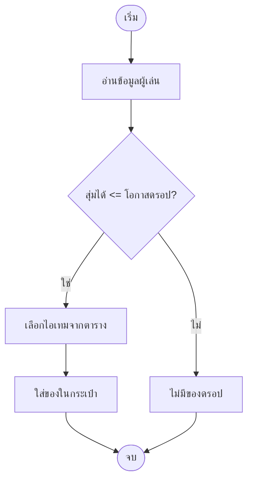
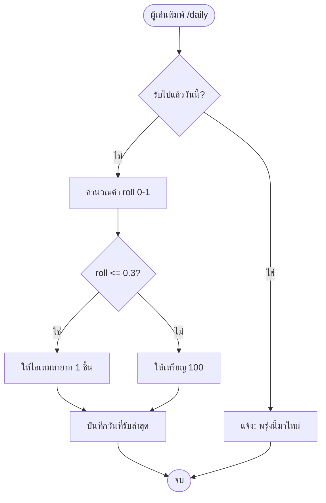
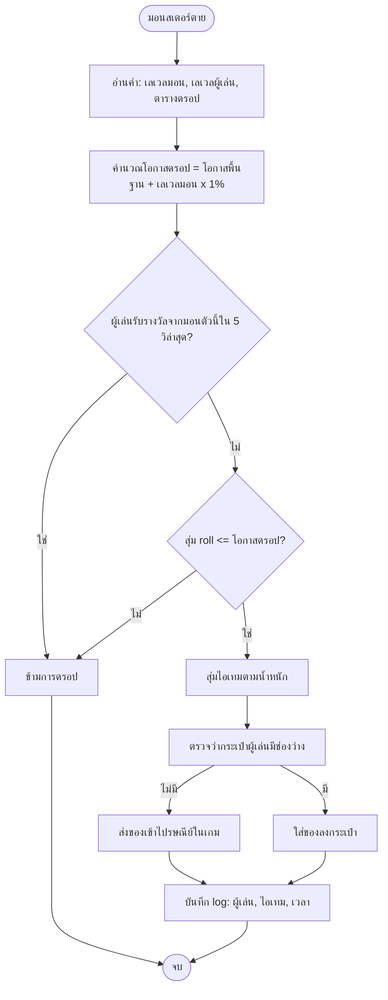

# Day 06 — เริ่มคิดแบบโปรแกรมเมอร์: ผังงานและตรรกะระบบสุ่มรางวัล

> 📅 Month 1 · Week 1 · ~150 นาที · **โหมด: Demonstration → Independent Practice**
> 🎯 วันนี้ยัง **ไม่เขียนโค้ดเกม** แต่ทำวันที่สำคัญที่สุดของเดือนนี้: ฝึก "คิดเป็นขั้นตอน"

---

## A. เป้าหมาย

จบบทนี้คุณจะ:
- อธิบายได้ว่าโปรแกรมทุกตัวมีโครงเดียวกัน: **อินพุต → ประมวลผล → เอาต์พุต**
- แยกโครงสร้างควบคุม 3 ชนิดได้: **ลำดับ (sequence)**, **เงื่อนไข (condition)**, **ลูป (loop)**
- วาดผังงาน (flowchart) ได้ด้วยสัญลักษณ์มาตรฐาน
- เขียน pseudocode ที่คนอื่นอ่านแล้วทำตามได้
- ออกแบบ **ระบบสุ่มรางวัล (loot)** ที่มีโอกาสดรอปต่างกัน พร้อมทดสอบเชิงตรรกะด้วยตาราง trace

**ผลงานที่ต้องได้:** `~/minecraft-mmo-dev/notes/loot-flow.md` ที่มีผังงาน + pseudocode + ตารางทดสอบ + การวิเคราะห์กรณีขอบ

---

## B. ความรู้ที่ต้องมี

- Day 01–05: Terminal, ไฟล์, Git
- **ไม่ต้องเขียนโค้ดมาก่อนเลย** — บทนี้คือการปูพื้นก่อนเขียนโค้ดจริงใน Month 2

---

## C. แนวคิด

### C.1 โปรแกรมทุกตัวหน้าตาเหมือนกัน

ลองนึกถึงการเก็บของจากมอนสเตอร์ใน Minecraft:

| ขั้น | คำถาม | ตัวอย่าง |
| --- | --- | --- |
| **อินพุต (Input)** | เรามีข้อมูลอะไร? | มอนสเตอร์ตาย, เลเวลผู้เล่น, ตารางดรอป |
| **ประมวลผล (Process)** | เอาข้อมูลมาคิดอะไร? | สุ่มเลข → เทียบกับโอกาสดรอป → เลือกไอเทม |
| **เอาต์พุต (Output)** | ผลลัพธ์คืออะไร? | ของถูกใส่กระเป๋า + ข้อความบอกผู้เล่น |

> 💡 เมื่ออธิบายโค้ดให้คนอื่นฟัง ให้พูดตาม 3 ขั้นนี้เสมอ — จะเข้าใจเร็วมาก

### C.2 โครงสร้างควบคุม 3 ชนิด (มีแค่นี้จริง ๆ)

1. **ลำดับ (Sequence)** — ทำทีละบรรทัดจากบนลงล่าง
   ตัวอย่าง: ผู้เล่นเข้าเกม → โหลดข้อมูล → แสดงข้อความต้อนรับ

2. **เงื่อนไข (Condition)** — ถ้า...ก็ทำ / ไม่งั้นทำอย่างอื่น
   ตัวอย่าง: ถ้าผู้เล่นมีสิทธิ์ VIP → ให้ของรางวัลพิเศษ

3. **ลูป (Loop)** — ทำซ้ำ
   ตัวอย่าง: ตรวจผู้เล่นทุกคนในปาร์ตี้ → แจกรางวัลให้ครบทุกคน

**ทุกโปรแกรมที่คุณจะเขียนใน 365 วันนี้สร้างจาก 3 อย่างนี้เท่านั้น** (ที่เหลือคือการซ้อนกัน)

### C.3 ผังงาน (Flowchart) และสัญลักษณ์



| รูปทรง | ความหมาย |
| --- | --- |
| วงรี (stadium) | เริ่ม / จบ |
| สี่เหลี่ยมผืนผ้า | การทำงาน 1 ขั้น |
| ข้าวหลามตัด (diamond) | เงื่อนไข (ต้องมีทางออกอย่างน้อย 2 ทาง) |
| สี่เหลี่ยมด้านขนาน | อินพุต / เอาต์พุต |
| วงกลม/จุดเชื่อม | จุดเชื่อมไปหน้าอื่น (ใช้เมื่อผังใหญ่) |

**กติกา 3 ข้อของการวาดผังงาน:**
1. ลูกศรต้องมีทิศเดียวชัดเจน ไม่มีเส้นตัดกันมั่ว
2. เงื่อนไขทุกอันต้องมีทางออกครบ (ใช่/ไม่) — **ห้ามมีทางตัน**
3. จุดจบต้องมีอย่างน้อย 1 จุด และทุกเส้นทางต้องไปถึงจุดจบได้

### C.4 Pseudocode — เขียนความคิดเป็นข้อ ๆ

**Pseudocode** = ภาษามนุษย์แบบมีโครงสร้าง ไว้อธิบายอัลกอริทึมก่อนเขียนโค้ดจริง

ตัวอย่าง:
```text
เริ่ม
  รับค่า: ผู้เล่น, มอนสเตอร์
  ถ้า ผู้เล่น ยังมีสิทธิ์รับรางวัล (ยังไม่ครบเวลา):
      คำนวณค่า roll = สุ่มระหว่าง 0.0 ถึง 1.0
      ถ้า roll <= โอกาสดรอปของมอนสเตอร์:
          เลือกไอเทมจากตาราง (ตามน้ำหนัก)
          เพิ่มไอเทมลงกระเป๋าผู้เล่น
          บันทึก log การรับรางวัล
      ไม่งั้น:
          ไม่มีรางวัล
  ไม่งั้น:
      แจ้งผู้เล่นว่ายังรับไม่ได้
จบ
```

> ⚠️ **ห้ามเขียน pseudocode แบบคลุมเครือ** เช่น "ทำการสุ่มและให้ของ" — ไม่บอกว่าใช้อะไรตัดสิน
> pseudocode ที่ดีต้องทำให้คนอื่นเขียนโค้ดตามได้เหมือนกัน

### C.5 ความน่าจะเป็น (Probability) สำหรับ Loot Table

ระบบดรอปของเกมมี 2 แบบที่ใช้บ่อย:

**แบบที่ 1: ดรอปแบบไบนารี (มี/ไม่มี)** — สุ่มตัวเลข 0–1 เทียบกับโอกาส

```text
โอกาสดรอป 20%  →  ถ้า random() <= 0.20 ให้ของ
```

**แบบที่ 2: ดรอปแบบมีน้ำหนัก (Weighted random)** — หลายไอเทม โอกาสต่างกัน

| ไอเทม | น้ำหนัก (weight) | โอกาส |
| --- | --- | --- |
| เหล็ก | 60 | 60/100 = 60% |
| ทอง | 25 | 25% |
| เพชร | 12 | 12% |
| ไอเทมระดับ Epic | 3 | 3% |
| **รวม** | **100** | **100%** |

**วิธีคิด:** สุ่มเลข 1–ผลรวมน้ำหนัก → ไล่หาว่าตกอยู่ในช่วงของไอเทมไหน

```text
roll = สุ่ม(1..100)
1  - 60  → เหล็ก
61 - 85  → ทอง
86 - 97  → เพชร
98 - 100 → Epic
```

> 💡 ในเกมจริงคุณจะปรับน้ำหนักบ่อยมาก — เก็บน้ำหนักไว้ในไฟล์ตั้งค่า (YAML) ไม่ใช่ในโค้ด (จะทำจริงใน Month 6–7)

### C.6 กรณีขอบ (Edge Cases) ที่มือใหม่มักลืม

| กรณี | ปัญหาถ้าไม่คิดไว้ | วิธีรับมือ |
| --- | --- | --- |
| ผู้เล่นยืนยันรางวัลสองครั้งพร้อมกัน | ของงอก (dupe) | บันทึก "รับรางวัลแล้ว" **ก่อน** ให้ของ |
| ผู้เล่นออกกลางคันระหว่างแจกรางวัล | ของหาย | ให้ของเสร็จก่อนบันทึกสถานะ หรือมีคิว/transaction |
| ตารางน้ำหนักรวมเป็น 0 | หารด้วยศูนย์ / พัง | ตรวจก่อนใช้ ถ้าเป็น 0 ให้แจ้งเตือน |
| น้ำหนักติดลบ | โอกาสคำนวณผิด | ตรวจค่าในช่วงที่ถูกต้อง (validate) |
| ผู้เล่นไม่มีช่องในกระเป๋า | ของหาย | ตรวจช่องก่อน หรือส่งของเข้าเมล/กล่องรับ |
| จำนวนครั้งต่อวันเกิน | เศรษฐกิจเฟ้อ | จำกัดจำนวนต่อวัน + บันทึกเวลา |

---

## D. ตัวอย่าง

### D.1 วิเคราะห์ผังงานของ "รางวัลรายวัน" (Daily Reward)



**วิเคราะห์โค้ดนี้ด้วยคำถาม 4 ข้อ** (ทักษะที่ต้องฝึก):
1. **อินพุต** มีอะไรบ้าง? (ผู้เล่น, วันที่ปัจจุบัน, ประวัติการรับล่าสุด)
2. **เงื่อนไข** มีกี่จุด? (2 จุด: รับไปแล้วหรือยัง, roll เทียบ 0.3)
3. **การบันทึกสถานะ** เกิดที่ไหน? (หลังให้รางวัล ที่ขั้น H)
4. ถ้าผู้เล่นรีสตาร์ทเซิร์ฟเวอร์ตอนขั้น D จะเกิดอะไร? (ไม่มีอะไรเสียหาย เพราะยังไม่บันทึก)

### D.2 ไล่ลำดับด้วยตาราง Trace Table

ตารางนี้ใช้ทดสอบตรรกะ **โดยไม่ต้องรันโปรแกรม** — มือใหม่ควรฝึกวิธีนี้ให้คล่อง

| ครั้ง | รับไปแล้ววันนี้? | roll | เงื่อนไข roll ≤ 0.3 | ผลลัพธ์ | บันทึกวันที่ |
| --- | --- | --- | --- | --- | --- |
| 1 | ไม่ | 0.12 | จริง | ไอเทมหายาก | ✅ |
| 2 | ใช่ | — | ไม่ถูกประเมิน | แจ้งพรุ่งนี้มาใหม่ | ❌ |
| 3 | ไม่ | 0.85 | เท็จ | เหรียญ 100 | ✅ |
| 4 | ไม่ | 0.30 | จริง (≤) | ไอเทมหายาก | ✅ |

> 📌 แถวที่ 4 สำคัญมาก: `<=` กับ `<` ให้ผลต่างกัน — **ต้องตัดสินใจให้ชัดและเขียนลงเอกสาร** เพราะมีผลต่อความน่าจะเป็นจริง

---

## E. ลงมือทำ

### ขั้นที่ 1: กำหนดระบบที่คุณจะออกแบบ

วันนี้ให้ออกแบบ **"ระบบดรอปของมอนสเตอร์"** ที่:
- มอนสเตอร์แต่ละตัวมีโอกาสดรอปพื้นฐาน (เช่น 20–60%)
- เมื่อดรอป จะสุ่มเลือกไอเทม 1 ชิ้นจากตารางน้ำหนัก
- มีโอกาสที่ของจะ "หายากขึ้นตามเลเวลมอน" (เช่น โบนัส 1% ต่อเลเวล)
- ผู้เล่นต้องไม่ได้รับรางวัลซ้ำเกิน 1 ครั้งต่อมอนสเตอร์ใน 5 วินาที (กันกดรัว)

### ขั้นที่ 2: เขียนผังงาน (ในไฟล์ Markdown)

สร้างไฟล์และวางผังงานด้วย Mermaid:

````markdown
# ระบบดรอปของมอนสเตอร์ — ผังงาน


````

### ขั้นที่ 3: เขียน pseudocode ให้ละเอียด

เขียน pseudocode ตามผังงานข้างบน ให้มี **ทุกเงื่อนไข** และระบุชัดว่าตัดสินใจอะไร ที่ไหน

### ขั้นที่ 4: ออกแบบตารางน้ำหนัก

สร้างตารางไอเทมของมอน 3 ตัว (เช่น ซอมบี้, โครงกระดูก, บอส) โดยที่:
- น้ำหนักรวมของแต่ละตารางต้องเป็น 100
- มีไอเทมอย่างน้อย 4 ชิ้นต่อมอน
- ใส่คอลัมน์ "โอกาส (%)" คำนวณให้ถูกต้อง

### ขั้นที่ 5: ทำตาราง Trace Table 8 กรณี

ทดสอบตรรกะด้วยตาราง โดยต้องมีครบ:
- กรณีปกติ 3 กรณี
- กรณี roll ติดขอบพอดี (เช่น roll = โอกาสดรอปพอดี)
- กรณีรับรางวัลซ้ำเร็วเกินไป
- กรณีกระเป๋าเต็ม
- กรณีโอกาสดรอปเกิน 100% (ควรจำกัดไว้ที่ 100%)
- กรณีน้ำหนักรวมผิด (ไม่ใช่ 100)

### ขั้นที่ 6: ระบุกรณีขอบ + วิธีรับมือ

เขียนตาราง 6 แถว: "ถ้าเกิด...ระบบจะทำอะไร" (ใช้หัวข้อ C.6 เป็นแนว)

### ขั้นที่ 7: เก็บงานเข้า Git

```bash
cd ~/minecraft-dev
mkdir -p docs/design
cp ~/minecraft-mmo-dev/notes/loot-flow.md docs/design/loot-system.md
git add docs/design/loot-system.md
git commit -m "docs: ออกแบบระบบดรอปของมอนสเตอร์ (ผังงาน + pseudocode + กรณีขอบ)"
```

---

## F. โค้ดตัวอย่าง

**หมายเหตุสำคัญ:** วันนี้เป็นวันแรกที่เรา "ออกแบบโดยยังไม่เขียนโค้ด"
แต่เพื่อให้เห็นภาพว่า pseudocode จะกลายเป็นโค้ดได้อย่างไร นี่คือตัวอย่างในภาษา Java **เพื่ออ่านเท่านั้น** (ยังไม่ต้องรัน):

```java
// ตัวอย่างสำหรับอ่าน — จะเขียนเองใน Month 8-9
public class LootRoller {

    // สุ่มไอเทมตามน้ำหนัก — สมมติ weights รวม = 100
    public String rollItem(int[] weights, String[] items, double randomValue) {
        // randomValue อยู่ในช่วง 0.0 - 1.0
        int target = (int) (randomValue * 100);   // 0..99
        int cumulative = 0;
        for (int i = 0; i < weights.length; i++) {
            cumulative += weights[i];
            if (target < cumulative) {
                return items[i];
            }
        }
        return items[items.length - 1];   // กันกรณีลอยนิดหน่อย (fallback)
    }
}
```

**อธิบาย 3 จุดสำคัญ:**
1. `randomValue * 100` แปลงช่วง 0.0–1.0 ให้เป็น 0–99 แล้วใช้เป็น "เลขทอย"
2. `cumulative` คือผลรวมสะสมของน้ำหนัก — ใช้เทียบว่าเลขทอยตกอยู่ในช่วงของไอเทมไหน
3. `fallback` จำเป็นเพราะเลขทศนิยมปัดเศษได้ — โค้ดที่ดีต้องมีทางออกสุดท้ายเสมอ

**พาธในโปรเจกต์จริงในอนาคต:** `~/minecraft-dev/src/main/java/.../LootRoller.java`

---

## G. แบบฝึกหัด

### G.1 พื้นฐาน

วาดผังงานระบบ **"ผู้เล่นใช้สกิล"** ที่มีตรรกะ:
1. ตรวจว่าสกิลอยู่ในคูลดาวน์หรือไม่
2. ตรวจว่ามีมานาพอหรือไม่
3. ถ้าผ่านทั้งสอง → ลดมานา, เริ่มคูลดาวน์, แสดงเอฟเฟกต์
4. ถ้าไม่ผ่าน → บอกผู้เล่นว่าติดอะไร (คูลดาวน์หรือมานา)

**สิ่งที่ต้องส่ง:** ผังงาน (Mermaid หรือวาดมือแล้วถ่ายภาพ) + อธิบาย 2 บรรทัด

### G.2 ประยุกต์

จากผังงานข้อ G.1 ให้ทำ 2 อย่าง:
1. เขียน pseudocode แบบมีเลขบรรทัด แล้วทำตาราง Trace 6 กรณี (รวมกรณีมานาพอแต่ติดคูลดาวน์, มานาไม่พอ, ทั้งคู่ผ่าน, ทั้งคู่ติด)
2. ระบุว่าต้องเก็บข้อมูลอะไร **ตอนนี้** เพื่อให้ระบบทำงานได้ (มานาปัจจุบัน, คูลดาวน์เหลือ, ID ของสกิล) และเก็บไว้ที่ไหน (memory/DB) พร้อมเหตุผล

**เป้าหมาย:** ข้อ 2 ทำให้คุณเริ่มคิดเรื่อง "สถานะ" (state) ซึ่งเป็นหัวใจของเกมทุกเกม

### G.3 คำถามตรวจสอบความเข้าใจ 3 ข้อ

1. ผังงานที่ดี ต้องมีเงื่อนไขที่ "ไม่มีทางออก" (ทางตัน) ได้หรือไม่ เพราะอะไร?
2. ถ้าตารางน้ำหนักรวมได้ 250 (ไม่ใช่ 100) การคำนวณโอกาสจะผิดอย่างไร และควรแก้ที่ไหน?
3. ทำไมระบบดรอปต้องบันทึก log ทุกครั้ง ทั้งที่เราไม่ค่อยเปิดดู?

---

## H. Challenge

ออกแบบระบบ **"กล่องรับรางวัลหลังจบดันเจี้ยน"** ที่:
- ผู้เล่น 4 คนในปาร์ตี้ทุกคนได้รางวัลของตัวเอง (ไม่แย่งกัน)
- มีโอกาสได้ของหายาก 5%
- ถ้าผู้เล่นตายระหว่างดันเจี้ยน (ถูก kick ออกไป) ต้องยังได้รางวัลถ้าทีมชนะบอส
- ถ้าบอสถูกกำจัด รางวัลต้องแจกครั้งเดียวเท่านั้น แม้ผู้เล่นจะกดยืนยันซ้ำ

ให้ส่ง:
1. ผังงาน
2. pseudocode
3. ระบุจุดที่ "ต้องบันทึกสถานะ" ทั้งหมด พร้อมเหตุผล
4. **ระบุ 3 จุดที่อาจเกิดบั๊ก** ถ้าเขียนโค้ดผิด (เช่น ลืมตรวจ, ตรวจผิดฝั่ง, ตรวจช้าเกินไป)

> 💡 Challenge นี้คือระบบเดียวกับที่คุณจะสร้างจริงใน Month 10 — เก็บไฟล์นี้ไว้ให้ดี

---

## I. Todo Checklist

- [ ] อ่านแนวคิด 3 ชนิดของโครงสร้างควบคุมและอธิบายได้
- [ ] วาดผังงานระบบดรอปของมอนสเตอร์ด้วย Mermaid
- [ ] เขียน pseudocode ที่มีทุกรายละเอียด (ไม่คลุมเครือ)
- [ ] ออกแบบตารางน้ำหนักของมอน 3 ตัว (รวม = 100)
- [ ] ทำตาราง Trace 8 กรณี
- [ ] ระบุกรณีขอบ 6 ข้อ + วิธีรับมือ
- [ ] ทำแบบฝึกหัด G.1, G.2 และตอบ G.3
- [ ] commit ไฟล์ออกแบบเข้า Git
- [ ] อัปเดต [PROGRESS.md](../../PROGRESS.md) + [TODO.md](../../TODO.md) (T-009)

---

## J. ผลลัพธ์

1. `~/minecraft-mmo-dev/notes/loot-flow.md` — เอกสารออกแบบที่ครบ (ผังงาน, pseudocode, น้ำหนัก, trace, กรณีขอบ)
2. `~/minecraft-dev/docs/design/loot-system.md` — ฉบับที่ commit เข้า Git แล้ว
3. `notes/skill-flow.md` — ผลงานจากแบบฝึกหัด G.1 (ระบบสกิล)
4. เข้าใจว่าโปรแกรม = อินพุต → ประมวลผล → เอาต์พุต และควบคุมด้วย 3 โครงสร้างเท่านั้น

---

## K. Troubleshooting

| อาการ | สาเหตุ | วิธีแก้ |
| --- | --- | --- |
| วาดผังงานแล้วมีทางตัน | ลืมใส่ทางออกของเงื่อนไข | ตรวจทุก diamond ว่ามี "ใช่" และ "ไม่" ครบ |
| pseudocode อ่านแล้วยังไม่รู้ว่าต้องเขียนโค้ดอย่างไร | ยังไม่ละเอียดพอ | เพิ่ม "ตัวแปรอะไร", "ค่าเริ่มต้นเท่าไร", "ตัดสินด้วยเงื่อนไขอะไร" |
| ตารางน้ำหนักรวมไม่เป็น 100 | บวกเลขผิดหรือออกแบบเกิน | ทบทวนและแก้ให้รวม 100 (หรือเปลี่ยนมาใช้ค่า "น้ำหนักรวมเท่าไรก็ได้" แต่ต้องคำนวณสัดส่วน) |
| Mermaid ไม่แสดงผลบนหน้าเว็บ | ต้องต่ออินเทอร์เน็ตเพื่อโหลดไลบรารี | ยังอ่านโค้ดดิบได้ และดูคำอธิบายด้านล่างไดอะแกรม |
| ไม่รู้จะเริ่มจากตรงไหน | เริ่มจากอินพุต/เอาต์พุตก่อนเสมอ | เขียน "อินพุตคืออะไร" และ "เอาต์พุตคืออะไร" แล้วค่อยเติมตรงกลาง |

---

## L. สรุป

- โปรแกรมทุกตัว = **อินพุต → ประมวลผล → เอาต์พุต** และใช้เพียง 3 โครงสร้าง: ลำดับ, เงื่อนไข, ลูป
- ผังงานทำให้เห็นภาพรวม; pseudocode ทำให้เห็นรายละเอียด; ตาราง trace ทำให้ **ทดสอบตรรกะโดยไม่ต้องรันโค้ด**
- ระบบดรอปมี 2 แบบหลัก: ไบนารี (มี/ไม่มี) และแบบน้ำหนัก (weighted random)
- กรณีขอบ (กดรัว, ออกกลางคัน, กระเป๋าเต็ม, ค่าผิด) คือสิ่งที่แยก "โปรแกรมที่รันได้" ออกจาก "เกมที่เปิดให้คนเล่นจริงได้"

**บทต่อไป (Day 07):** 🔁 วันทบทวนสัปดาห์แรก — เราจะรวมทุกอย่างที่เรียนมาเป็น **script ตรวจสุขภาพเซิร์ฟเวอร์ (`server-check.sh`)**
ซึ่งเป็นเครื่องมือที่คุณจะใช้จริงตลอดหลักสูตร และประเมินความพร้อมก่อนขึ้นเดือนที่ 2

---

## M. Progress Update

```text
### Day 006 — วันที่ ____-__-__
- เรียน: โครงสร้างโปรแกรม (อินพุต/ประมวลผล/เอาต์พุต), เงื่อนไข/ลูป, ผังงาน, pseudocode, ความน่าจะเป็น, กรณีขอบ
- ทำเสร็จ: notes/loot-flow.md + ~/minecraft-dev/docs/design/loot-system.md (commit แล้ว) + notes/skill-flow.md
- ทดสอบ: ทำตาราง trace 8 กรณี + ระบุกรณีขอบ 6 ข้อ (ตรวจด้วยตา ไม่ใช่รันโค้ด)
- ยังไม่เข้าใจ: ______
- Error ที่เจอ: ______ (แก้ด้วย ______)
- งานถัดไป: Day 07 — REVIEW สัปดาห์ 1 + server-check.sh
- คะแนนตัวเอง: __/5
```
