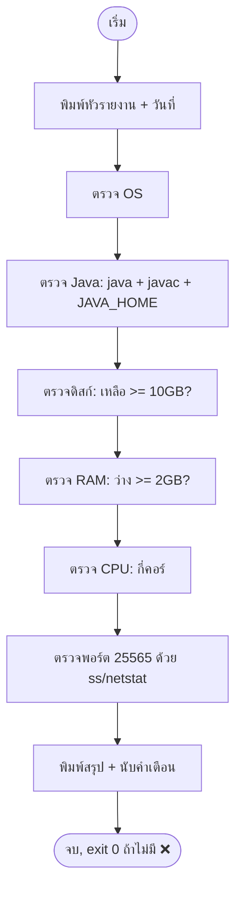

# Day 07 — 🔁 REVIEW สัปดาห์ที่ 1 + สร้าง `server-check.sh`

> 📅 Month 1 · Week 1 (วันทบทวน) · ~150 นาที · **โหมด: Review → Independent Practice**
> 🎯 วันนี้ไม่มีเนื้อหาใหม่ แต่เป็นวันที่ **เปลี่ยนความรู้เป็นเครื่องมือใช้จริง**

---

## A. เป้าหมาย

จบบทนี้คุณจะ:
- ทบทวนความรู้ Day 01–06 ผ่านการสร้างเครื่องมือจริง (ไม่ใช่การจำ)
- เขียน script `server-check.sh` ที่ตรวจ 6 ด้านของเครื่อง: OS, Java, พื้นที่ดิสก์, RAM, CPU, พอร์ตที่ใช้อยู่
- ให้คะแนนตัวเองอย่างซื่อสัตย์ และระบุจุดที่ต้องทบทวน
- commit งานทั้งสัปดาห์เข้า Git เพื่อไม่ให้หาย
- ตัดสินใจได้ว่าพร้อมไป Month 2 หรือต้องทบทวนวันไหนเพิ่ม

**ผลงานที่ต้องได้:** `~/minecraft-mmo-dev/scripts/server-check.sh` ที่รันได้ + ผลลัพธ์จริง + ตารางคะแนนใน PROGRESS.md

---

## B. ความรู้ที่ต้องมี (ทั้งหมดของสัปดาห์นี้)

| Day | เรื่อง | ต้องทำได้ |
| --- | --- | --- |
| 01 | Terminal, พาธ, โครงโฟลเดอร์ | สร้าง/เข้าโฟลเดอร์ด้วยพาธเต็มและสัมพัทธ์ได้ |
| 02 | ไฟล์, สิทธิ์, script แรก | เขียน script มี shebang, `chmod 755`, รับ argument |
| 03 | `PATH`, `find`, `grep`, alias | หาไฟล์/ข้อความได้, ตั้ง alias ถาวรได้ |
| 04 | โปรเซส, pacman, VS Code, JDK 25 | ติดตั้งเครื่องมือและตรวจเวอร์ชันได้ |
| 05 | Git | commit งานทุกวันและย้อนดูประวัติได้ |
| 06 | ผังงาน, pseudocode, ความน่าจะเป็น | ออกแบบตรรกะก่อนเขียนโค้ดได้ |

**ถ้าข้อไหนยังทำไม่ได้** ให้จดไว้แล้วทบทวนวันนั้น 20 นาทีก่อนเริ่ม Month 2 (ไม่ต้องเริ่มใหม่ทั้งเดือน)

---

## C. แนวคิด (ทบทวนแบบ "เข้าใจ ไม่ใช่จำ")

### C.1 ทำไมต้องมี script ตรวจสุขภาพเซิร์ฟเวอร์

เมื่อเซิร์ฟเวอร์มีปัญหา ผู้เล่นจะบอกว่า "เล่นไม่ได้ แลคมาก" — ซึ่งไม่บอกสาเหตุ
ผู้ดูแลที่เก่งจะถามกลับด้วย **ข้อมูล** เช่น:

- พื้นที่ดิสก์เหลือเท่าไร? (เต็มแล้วเซิร์ฟเวอร์เขียนโลกไม่ได้ → crash)
- RAM เหลือเท่าไร? (ไม่พอ → ถูกฆ่า OOM)
- Java เวอร์ชันตรงไหม? (ไม่ตรง → เปิดไม่ขึ้น)
- พอร์ต 25565 ถูกใช้อยู่ไหม? (ถูกใช้ → bind ไม่ได้)

`server-check.sh` จะตอบคำถามเหล่านี้ทั้งหมดในคำสั่งเดียว — นี่คือ "เครื่องมือวินิจฉัย" ตัวแรกของคุณ

### C.2 หลักการเขียน script ที่ดี (ใช้กับทุก script ตลอดหลักสูตร)

| หลักการ | ทำไม |
| --- | --- |
| มี shebang + comment อธิบายหัวไฟล์ | คนอื่น (และตัวคุณในอนาคต) เข้าใจว่าใช้อย่างไร |
| ตรวจ argument / เงื่อนไขก่อนทำงาน | ลดความเสียหายจาก input ผิด |
| ใช้ `command -v <คำสั่ง>` ก่อนเรียกใช้ | ถ้าเครื่องนั้นไม่มีคำสั่ง จะไม่พังแบบน่าเกลียด |
| แสดงผลเป็นหมวด ๆ มีสถานะ ✅ / ⚠️ / ❌ | อ่านผลลัพธ์แล้วรู้ทันทีว่าต้องแก้อะไร |
| `set -uo pipefail` | ให้ script หยุดเมื่อมีตัวแปรไม่ถูกกำหนด และจับ error ในท่อคำสั่ง |
| **ไม่แก้ไขอะไร** — ตรวจเท่านั้น | เครื่องมือตรวจไม่ควรทำให้ระบบเปลี่ยน (จะปลอดภัยเสมอเมื่อเรียกใช้) |

> ⚠️ `set -e` (หยุดเมื่อมีคำสั่งล้มเหลว) ใช้ในสคริปต์ตรวจสอบได้ แต่ต้องระวัง: บางคำสั่ง "ล้มเหลว" เป็นเรื่องปกติ
> เช่น `grep` ที่ไม่เจออะไร → ใน script นี้เราจึงใช้ `set -uo pipefail` โดยไม่ใส่ `-e` แล้วจัดการเอง

---

## D. ตัวอย่าง

### D.1 ผลลัพธ์ที่ต้องการของ `server-check.sh`

```text
==========================================
 Server Check — Eclipse MMO RPG Academy
==========================================
วันที่ตรวจ: 2026-10-27 21:15:03
เครื่อง: cachyos-pc (Linux x86_64)

[1] ระบบปฏิบัติการ
    ✅ CachyOS / Arch-based (ตรวจจาก /etc/os-release)
    ⏱️  uptime: 3 วัน 4 ชั่วโมง

[2] Java
    ✅ java: 25.0.5  (ต้องการ 25 สำหรับ Paper 26.x)
    ✅ javac: 25.0.5
    ⚠️  JAVA_HOME ไม่ได้ตั้งค่า (อาจทำให้เครื่องมืออื่นหา Java ไม่เจอ)

[3] พื้นที่ดิสก์
    ✅ เหลือ 240 GB จาก 500 GB (48.0% ใช้ไป) — ผ่านเกณฑ์ 10 GB

[4] หน่วยความจำ
    ✅ RAM รวม 31.2 GB | ว่าง 18.4 GB — เพียงพอสำหรับเซิร์ฟเวอร์ 4 GB

[5] CPU
    ✅ 8 คอร์ — เพียงพอสำหรับเซิร์ฟเวอร์ทดสอบ

[6] พอร์ต
    ✅ พอร์ต 25565 ว่าง (พร้อมให้เซิร์ฟเวอร์ใช้)
    ℹ️  เปิดใช้งานอยู่ 3 พอร์ต (ไม่ใช่ 25565)

------------------------------------------
สรุป: ผ่าน 5/6 หมวด · มีคำเตือน 1 รายการ
```

> 💡 ค่าจริงบนเครื่องคุณจะต่างจากตัวอย่าง — สิ่งสำคัญคือ **รูปแบบการรายงาน**

### D.2 โครงสร้าง script ที่จะเขียน



---

## E. ลงมือทำ

### ขั้นที่ 1: ทบทวนเร็ว 10 นาที (รันคำสั่งเดิมซ้ำจากสัปดาห์นี้)

```bash
cd ~/minecraft-mmo-dev && pwd && ls -la
mmd && pwd                 # alias จาก Day 03
findscript                 # ต้องเห็นไฟล์ .sh ของตัวเอง
cd ~/minecraft-dev && git log --oneline
```

ถ้าคำสั่งไหนใช้ไม่ได้ ให้เปิดบทเรียนวันนั้นทบทวนทันที (ใช้เวลาไม่เกิน 20 นาที)

### ขั้นที่ 2: เขียน `server-check.sh` — ส่วนที่ 1 (หัวรายงาน + ฟังก์ชันช่วย)

สร้างไฟล์ `~/minecraft-mmo-dev/scripts/server-check.sh`:

```bash
#!/usr/bin/env bash
# server-check.sh — ตรวจสุขภาพเครื่องสำหรับเซิร์ฟเวอร์ Minecraft
# ใช้: ./server-check.sh
# หลักการ: ตรวจเท่านั้น ไม่แก้ไขอะไรในระบบ

set -uo pipefail

WARN_COUNT=0
FAIL_COUNT=0
REQUIRED_JAVA=25
MIN_DISK_GB=10
MIN_RAM_GB=2
MC_PORT=25565
SERVER_DIR="$HOME/minecraft-mmo-dev/server"

# ฟังก์ชันช่วยพิมพ์ผล
ok()   { echo "    ✅ $1"; }
warn() { echo "    ⚠️  $1"; WARN_COUNT=$((WARN_COUNT + 1)); }
fail() { echo "    ❌ $1"; FAIL_COUNT=$((FAIL_COUNT + 1)); }
info() { echo "    ℹ️  $1"; }
```

**อธิบาย:** การห่อ `echo` เป็นฟังก์ชัน `ok/warn/fail` ทำให้ทั้งไฟล์อ่านง่าย และนับจำนวนปัญหาได้อัตโนมัติ

### ขั้นที่ 3: ส่วนที่ 2 — หัวรายงานและระบบ OS

```bash
echo "=========================================="
echo " Server Check — Eclipse MMO RPG Academy"
echo "=========================================="
echo "วันที่ตรวจ: $(date '+%Y-%m-%d %H:%M:%S')"
echo "เครื่อง: $(hostname) ($(uname -s) $(uname -m))"
echo

echo "[1] ระบบปฏิบัติการ"
if [ -r /etc/os-release ]; then
    # shellcheck disable=SC1091
    . /etc/os-release
    ok "${PRETTY_NAME:-ไม่ทราบชื่อระบบ}"
else
    warn "ไม่พบ /etc/os-release (ตรวจระบบไม่ได้)"
fi
if command -v uptime >/dev/null 2>&1; then
    info "uptime: $(uptime -p 2>/dev/null || uptime)"
fi
echo
```

### ขั้นที่ 4: ส่วนที่ 3 — Java (สำคัญที่สุด)

```bash
echo "[2] Java (Paper 26.x ต้องใช้ Java $REQUIRED_JAVA)"
if command -v java >/dev/null 2>&1; then
    JAVA_RAW=$(java -version 2>&1 | head -1)
    JAVA_MAJOR=$(echo "$JAVA_RAW" | sed -E 's/.*version "([0-9]+).*/\1/')
    if [ "$JAVA_MAJOR" = "$REQUIRED_JAVA" ]; then
        ok "java: $JAVA_MAJOR (ตรงกับที่ Paper ต้องการ)"
    else
        fail "java: $JAVA_MAJOR แต่ต้องใช้ $REQUIRED_JAVA"
    fi
    if command -v javac >/dev/null 2>&1; then
        ok "javac: $(javac -version 2>&1 | sed -E 's/javac //')"
    else
        warn "ไม่พบ javac (ติดตั้ง JRE อย่างเดียว? ต้องใช้ JDK)")
    fi
    if [ -z "${JAVA_HOME:-}" ]; then
        warn "JAVA_HOME ไม่ได้ตั้งค่า (ทำให้เครื่องมืออื่นหา Java ไม่เจอ)"
    else
        ok "JAVA_HOME = $JAVA_HOME"
    fi
else
    fail "ไม่พบคำสั่ง java (ดู Day 04)"
fi
echo
```

### ขั้นที่ 5: ส่วนที่ 4 — ดิสก์และ RAM (แปลงค่าด้วย `awk`)

```bash
echo "[3] พื้นที่ดิสก์ (ต้องการว่างอย่างน้อย ${MIN_DISK_GB} GB)"
DISK_LINE=$(df -k "$HOME" | tail -1)
AVAIL_GB=$(echo "$DISK_LINE" | awk '{printf "%.1f", $4/1024/1024}')
USED_PCT=$(echo "$DISK_LINE" | awk '{print $5}')
if awk -v a="$AVAIL_GB" -v m="$MIN_DISK_GB" 'BEGIN{exit !(a >= m)}'; then
    ok "เหลือ ${AVAIL_GB} GB (ใช้ไป ${USED_PCT})"
else
    fail "เหลือเพียง ${AVAIL_GB} GB — ควรลบไฟล์ log/build เก่า"
fi
echo

echo "[4] หน่วยความจำ"
if command -v free >/dev/null 2>&1; then
    TOTAL_MB=$(free -m | awk '/^Mem:/{print $2}')
    AVAIL_MB=$(free -m | awk '/^Mem:/{print $7}')
    TOTAL_GB=$(awk -v t="$TOTAL_MB" 'BEGIN{printf "%.1f", t/1024}')
    AVAIL_GB=$(awk -v t="$AVAIL_MB" 'BEGIN{printf "%.1f", t/1024}')
    if awk -v a="$AVAIL_GB" -v m="$MIN_RAM_GB" 'BEGIN{exit !(a >= m)}'; then
        ok "RAM รวม ${TOTAL_GB} GB | ว่าง ${AVAIL_GB} GB"
    else
        warn "RAM ว่างเพียง ${AVAIL_GB} GB (น้อยกว่าเกณฑ์ ${MIN_RAM_GB} GB)"
    fi
else
    warn "ไม่พบคำสั่ง free — ข้ามการตรวจ RAM"
fi
echo
```

**อธิบาย `awk` 3 บรรทัดนี้:**
- `awk '{printf "%.1f", $4/1024/1024}'` → เอา 1 กิโลไบต์ → กิกะไบต์ (หาร 1024 สองครั้ง) แล้วแสดงทศนิยม 1 ตำแหน่ง
- `awk -v a=$AVAIL_GB -v m=$MIN_DISK_GB 'BEGIN{exit !(a >= m)}'` → เทียบตัวเลข (bash เทียบทศนิยมตรง ๆ ไม่ได้!)
- `exit !(a>=m)` → ถ้าจริง exit 0 (ผ่าน) ถ้าเท็จ exit 1 (ไม่ผ่าน)

> 💡 **นี่คือความรู้สำคัญ:** bash แยก string กับตัวเลขไม่เก่ง การเทียบทศนิยมต้องใช้ `awk` หรือ `bc`

### ขั้นที่ 6: ส่วนที่ 5 — CPU และพอร์ต

```bash
echo "[5] CPU"
CORES=$(nproc 2>/dev/null || echo "ไม่ทราบ")
if [ "$CORES" != "ไม่ทราบ" ] && [ "$CORES" -ge 2 ]; then
    ok "${CORES} คอร์"
elif [ "$CORES" != "ไม่ทราบ" ]; then
    warn "${CORES} คอร์ (น้อยกว่าที่แนะนำ 2 คอร์)"
else
    warn "ตรวจจำนวน CPU ไม่ได้"
fi
echo

echo "[6] พอร์ต $MC_PORT"
PORT_BUSY="ไม่ทราบ"
if command -v ss >/dev/null 2>&1; then
    if ss -tuln 2>/dev/null | grep -q ":$MC_PORT "; then PORT_BUSY="ใช่"; else PORT_BUSY="ไม่"; fi
elif command -v netstat >/dev/null 2>&1; then
    if netstat -tuln 2>/dev/null | grep -q ":$MC_PORT "; then PORT_BUSY="ใช่"; else PORT_BUSY="ไม่"; fi
else
    warn "ไม่พบ ss/netstat — ตรวจพอร์ตไม่ได้"
fi

case "$PORT_BUSY" in
    "ไม่") ok "พอร์ต $MC_PORT ว่าง (พร้อมให้เซิร์ฟเวอร์ใช้)" ;;
    "ใช่") warn "พอร์ต $MC_PORT ถูกใช้อยู่ (มีเซิร์ฟเวอร์รันอยู่แล้ว?)" ;;
    *)     warn "ตรวจพอร์ตไม่ได้ (ไม่มีเครื่องมือ)" ;;
esac

if [ -d "$SERVER_DIR" ]; then
    info "โฟลเดอร์เซิร์ฟเวอร์: $SERVER_DIR ($(find "$SERVER_DIR" -type f 2>/dev/null | wc -l) ไฟล์)"
else
    info "ยังไม่มีโฟลเดอร์เซิร์ฟเวอร์: $SERVER_DIR (จะสร้างใน Month 5)"
fi
echo
```

### ขั้นที่ 7: ส่วนที่ 6 — สรุปผลและ exit code

```bash
echo "------------------------------------------"
if [ "$FAIL_COUNT" -eq 0 ] && [ "$WARN_COUNT" -eq 0 ]; then
    echo "สรุป: ✅ ผ่านทุกหมวด ไม่มีคำเตือน"
    exit 0
elif [ "$FAIL_COUNT" -eq 0 ]; then
    echo "สรุป: ⚠️ ผ่านทุกหมวด แต่มีคำเตือน $WARN_COUNT รายการ"
    exit 0
else
    echo "สรุป: ❌ มีปัญหาต้องแก้ $FAIL_COUNT รายการ (คำเตือน $WARN_COUNT รายการ)"
    exit 1
fi
```

> 💡 ถ้าอยากดูไฟล์สำเร็จรูปเพื่อเทียบผล ให้เปิด [projects/01-linux-lab/scripts/server-check.sh](../../projects/01-linux-lab/scripts/server-check.sh)
> — แต่ต้องพิมพ์เองและลองรันเองก่อน จึงจะเทียบ (ถ้าเทียบก่อนเขียน จะไม่ได้ฝึกแก้ error จริง)

### ขั้นที่ 8: ให้สิทธิ์ รัน และตรวจผล

```bash
cd ~/minecraft-mmo-dev/scripts
chmod 755 server-check.sh
./server-check.sh
echo "exit code = $?"
```

**ทดสอบให้ครบ 3 กรณี** (สำคัญ — script ที่ดีต้องรันได้หลายสภาพแวดล้อม):

```bash
./server-check.sh > ~/minecraft-mmo-dev/notes/day07-server-check.txt 2>&1   # 1) ปกติ
PATH=/usr/bin ./server-check.sh | tail -12                                   # 2) PATH จำกัด (จำลอง java ไม่เจอ)
bash server-check.sh | head -5                                               # 3) เรียกผ่าน bash ตรง ๆ
```

### ขั้นที่ 9: ให้คะแนนตัวเอง (ทำอย่างซื่อสัตย์)

เปิด [PROGRESS.md](../../PROGRESS.md) แล้วกรอกตารางคะแนนสัปดาห์ที่ 1:

| หัวข้อ | 1 = ทำไม่ได้เลย | 3 = ทำตามได้ | 5 = ทำเองได้และดัดแปลงได้ |
| --- | --- | --- | --- |
| Terminal / พาธ | | | |
| สิทธิ์ไฟล์และ script | | | |
| `PATH`, `find`, `grep` | | | |
| เครื่องมือ (JDK, VS Code) | | | |
| Git | | | |
| ตรรกะ/ผังงาน | | | |

**กติกา:** ถ้าหัวข้อใดได้ ≤2 ให้วางแผนทบทวน 20 นาทีในวันถัดไป (ไม่ต้องเริ่มเดือนใหม่ทั้งเดือน)

### ขั้นที่ 10: commit งานทั้งสัปดาห์

```bash
cd ~/minecraft-dev
cp ~/minecraft-mmo-dev/scripts/server-check.sh scripts/ 2>/dev/null || mkdir -p scripts && cp ~/minecraft-mmo-dev/scripts/server-check.sh scripts/
cp ~/minecraft-mmo-dev/notes/loot-flow.md docs/design/ 2>/dev/null
git add -A
git status
git commit -m "feat: เพิ่มสคริปต์ตรวจสุขภาพเซิร์ฟเวอร์ + เอกสารออกแบบระบบดรอป (สัปดาห์ที่ 1)"
git log --oneline --graph
```

---

## F. โค้ดตัวอย่าง

ไฟล์ที่ต้องมีหลังจบวันนี้:

| พาธ | สถานะ | หน้าที่ |
| --- | --- | --- |
| `~/minecraft-mmo-dev/scripts/server-check.sh` | สร้างใหม่ | ตรวจสุขภาพเครื่อง 6 ด้าน |
| `~/minecraft-mmo-dev/notes/day07-server-check.txt` | สร้างใหม่ | หลักฐานผลการรัน |
| `~/minecraft-dev/scripts/server-check.sh` | คัดลอกเข้า repo | เก็บประวัติงานใน Git |
| `~/minecraft-mmo-dev/notes/week1-review.md` | สร้างใหม่ (แบบฝึกหัด) | สรุปสิ่งที่เรียน + จุดที่ต้องทบทวน |

โค้ดเต็มของ script อยู่ในขั้นที่ 2–7 (ประกอบต่อกันเป็นไฟล์เดียว)
**หมายเหตุ:** ถ้าอยากได้ไฟล์สำเร็จรูปไปเทียบ ให้เปิด [projects/01-linux-lab/scripts/server-check.sh](../../projects/01-linux-lab/scripts/server-check.sh)
แต่ **ต้องพิมพ์เองก่อน** แล้วค่อยเทียบ (การพิมพ์เองคือการเรียนรู้)

---

## G. แบบฝึกหัด

### G.1 พื้นฐาน (งานหลักของวันนี้)

1. เขียน `server-check.sh` ให้รันได้ครบ 6 หมวด และแก้ข้อความที่ไม่ใช่ภาษาไทยให้ถูกต้อง
2. ทดสอบ 3 กรณีตามขั้นที่ 8 และบันทึกผลลง `notes/day07-server-check.txt`
3. ตรวจว่า `echo $?` ให้ค่า 0 (เมื่อไม่มี ❌) และ 1 (เมื่อมี ❌)

### G.2 ประยุกต์

เพิ่มหมวดที่ 7 ให้ script: **"ตรวจโครงสร้างโปรเจกต์"** ให้ตรวจว่ามีโฟลเดอร์เหล่านี้อยู่หรือไม่
`~/minecraft-mmo-dev/{server,scripts,notes,backups,lab,academy}` และรายงานว่าขาดอันไหน
พร้อมเพิ่มเกณฑ์ใหม่ในความคิดของคุณ: ถ้าขาดมากกว่า 2 โฟลเดอร์ ให้เป็น `warn`

**สิ่งที่ต้องส่ง:** โค้ดส่วนที่เพิ่ม + ผลการรัน 2 กรณี (มีครบ / ลบโฟลเดอร์ทดลอง 1 อันแล้วรันใหม่ — แล้วสร้างคืน)

### G.3 คำถามตรวจสอบความเข้าใจ 3 ข้อ

1. ทำไมต้องใช้ `command -v` ก่อนเรียกคำสั่งใน script? ถ้าไม่ใช้จะเกิดอะไรขึ้นบนเครื่องที่ไม่มีคำสั่งนั้น?
2. ทำไมการเทียบเลขทศนิยมใน bash ต้องใช้ `awk` (หรือ `bc`) แทน `[ "$a" -gt "$b" ]`?
3. `exit 0` กับ `exit 1` ต่างกันอย่างไร และทำไมผู้ดูแลเซิร์ฟเวอร์ควรสนใจค่านี้ (คำใบ้: ใช้ต่อกับ `&&`/`||` หรือระบบแจ้งเตือน)

---

## H. Challenge

ทำให้ `server-check.sh` **บันทึกผลลงไฟล์ log ได้** และ **เทียบกับครั้งก่อนหน้า**:

1. รับ argument `--log` เพื่อบันทึกผลลง `~/minecraft-mmo-dev/backups/checks/server-check-YYYY-MM-DD.log`
2. สร้างโฟลเดอร์ให้เองถ้ายังไม่มี (`mkdir -p`)
3. ถ้ามีไฟล์ของ "เมื่อวาน" ให้เทียบว่า Java version/พื้นที่ดิสก์เปลี่ยนไปเท่าไร แล้วพิมพ์ส่วน "เปรียบเทียบ" 1 บรรทัด
4. ให้ script ยังคืนค่า `exit 0/1` ตามเดิม

**สิ่งที่ต้องส่ง:** โค้ดที่เพิ่ม + ผลการรัน 2 ครั้ง (ครั้งแรกสร้างไฟล์, ครั้งที่สองเทียบกับครั้งแรกได้)

> 💡 โจทย์นี้คือพื้นฐานของระบบมอนิเตอร์จริงใน Month 11 (Day 320) — คุณกำลังสร้างของจริงไปแล้ว

---

## I. Todo Checklist

- [ ] ทบทวนคำสั่งจาก Day 01–06 (รันซ้ำอย่างน้อย 5 คำสั่ง)
- [ ] เขียน `server-check.sh` ครบ 6 หมวด
- [ ] แก้ข้อความที่หลุดจากภาษาอื่นให้เป็นภาษาไทย
- [ ] ทดสอบ 3 กรณี + เก็บผลลงไฟล์
- [ ] ตรวจ exit code ทั้งกรณีผ่านและไม่ผ่าน
- [ ] เพิ่มหมวดที่ 7 (แบบฝึกหัด G.2)
- [ ] กรอกตารางคะแนนสัปดาห์ที่ 1 ใน PROGRESS.md อย่างซื่อสัตย์
- [ ] เขียน `notes/week1-review.md` สรุปสิ่งที่เรียน + จุดที่ต้องทบทวน
- [ ] commit งานทั้งสัปดาห์เข้า Git
- [ ] อัปเดต [TODO.md](../../TODO.md) : T-010 เป็น `COMPLETED`, T-001–T-009 ตามจริง

---

## J. ผลลัพธ์

1. `scripts/server-check.sh` ที่รันได้จริง 6 หมวด (+ หมวดที่ 7 จากแบบฝึกหัด)
2. หลักฐานผลการรัน 3 กรณีใน `notes/day07-server-check.txt`
3. ตารางคะแนนสัปดาห์ที่ 1 ใน PROGRESS.md + ไฟล์ทบทวน `notes/week1-review.md`
4. งานทั้งสัปดาห์เข้า Git เรียบร้อย (ย้อนดูได้)
5. ข้อสรุปชัดเจน: พร้อมไป Month 2 หรือต้องทบทวนวันไหนเพิ่ม

---

## K. Troubleshooting

| อาการ | สาเหตุ | วิธีตรวจสอบ | วิธีแก้ |
| --- | --- | --- | --- |
| `syntax error near unexpected token` | พิมพ์เครื่องหมายไม่ครบคู่ (`"` หรือ `fi` หาย) | `bash -n server-check.sh` (ตรวจ syntax โดยไม่รัน) | แก้บรรทัดที่ error ระบุ |
| ผลลัพธ์ขึ้นค่าแปลก ๆ เช่น `0.0 GB` | `df` แสดงคอลัมน์ต่างจากที่คิด | รัน `df -k ~` ดูผลจริง | ปรับเลขคอลัมน์ใน `awk '{print $4}'` ตามผลจริง |
| `[ "$CORES" -ge 2 ]: integer expression expected` | `nproc` คืนค่าที่ไม่ใช่ตัวเลข | `echo "$CORES"` | เพิ่มการตรวจว่าเป็นตัวเลขก่อนเทียบ (`case` หรือ `[[ "$CORES" =~ ^[0-9]+$ ]]`) |
| `unbound variable` | ใช้ `set -u` แล้วอ้างตัวแปรที่ยังไม่ถูกตั้งค่า | ดูเลขบรรทัดจาก error | ใช้ `${VAR:-}` สำหรับตัวแปรที่อาจว่าง |
| `sed -E` ใช้ไม่ได้ | `sed` รุ่นเก่าบางตัวไม่รองรับ `-E` | `sed --version` | ใช้ `sed -r` แทน (หรืออัปเดต) |
| ตรวจพอร์ตแล้วบอก "ไม่ทราบ" | ไม่มีทั้ง `ss` และ `netstat` | `command -v ss netstat` | ติดตั้ง `iproute2`/`net-tools` หรือถือว่ายอมรับได้ (script ไม่พัง) |
| script ทำงานแต่ exit code ไม่ตรงที่คาด | มีคำสั่งอื่นเปลี่ยน `$?` หลังสุด | `echo $?` ทันทีหลังรัน | ตรวจว่าบรรทัดสุดท้ายเป็นการเรียก `exit` จริง |

---

## L. สรุปสัปดาห์ที่ 1

**สิ่งที่คุณทำได้แล้ว (ตรวจสอบได้จริง):**
- ใช้ Terminal สร้าง/จัดการไฟล์และโฟลเดอร์ได้
- เขียน script ที่ใช้ได้จริง 3 ไฟล์ (`first-script.sh`, `java-check.sh`, `server-check.sh`)
- ใช้ `find`/`grep`/`awk`/`sed` แก้ปัญหาจริงได้
- ติดตั้ง JDK 25 + VS Code และพิสูจน์เวอร์ชันได้
- ใช้ Git เก็บงานและย้อนดูประวัติได้
- ออกแบบตรรกะเกมก่อนเขียนโค้ด (ผังงาน + pseudocode + trace)
- สร้างเครื่องมือวินิจฉัยเซิร์ฟเวอร์ตัวแรกของตัวเอง

**ความเชื่อมโยงกับเดือนถัดไป:** เดือนที่ 2 จะใช้ shell script ฝึกตรรกะการเขียนโปรแกรมให้แน่น
ก่อนย้ายไปภาษา Java ในเดือนที่ 3 — script ที่เขียนในเดือนนี้จะถูกใช้ **จริง** เมื่อเราสร้างเซิร์ฟเวอร์ใน Month 5

---

## M. Progress Update

```text
### Day 007 — วันที่ ____-__-__ (REVIEW สัปดาห์ที่ 1)
- ทบทวน: Day 01-06 (Terminal, สิทธิ์, PATH/find/grep, เครื่องมือ, Git, ผังงาน)
- ทำเสร็จ: scripts/server-check.sh (6+1 หมวด), notes/day07-server-check.txt, notes/week1-review.md
- ทดสอบ: 3 กรณี (ปกติ / PATH จำกัด / เรียกผ่าน bash) + exit code 0 และ 1 ✅
- คะแนนสัปดาห์ที่ 1: Terminal __ | สิทธิ์/script __ | PATH/find/grep __ | เครื่องมือ __ | Git __ | ตรรกะ __
- จุดที่ต้องทบทวน: ______ (แผน: ทบทวน __ นาที ในวัน ______)
- ยังไม่เข้าใจ: ______
- งานถัดไป: Day 008 — shell script: ตัวแปร, อาร์กิวเมนต์, อินพุตผู้ใช้ (Month 2)
- ความพร้อมไป Month 2: ☐ พร้อม ☐ ต้องทบทวนก่อน
```
