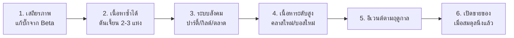

# 07-mmo-rpg — เป้าหมายระยะยาว (MMO RPG Server)

> 🎯 **เป้าหมาย:** เซิร์ฟเวอร์ MMO RPG ที่มีผู้เล่นจริง มีเศรษฐกิจ เนื้อหา และการดูแลที่ยั่งยืน
> 📅 ใช้ใน: Month 08–12 (ต่อจาก [06-eclipse-core](../06-eclipse-core/README.md))
> ⏳ **สถานะ: ยังไม่เริ่ม** — เอกสารนี้คือ "เป้าหมายและเกณฑ์ตัดสินใจ" ไม่ใช่โค้ด

---

## 1. ระบบเป้าหมาย 20 ข้อ และจุดตัดสินใจสำคัญ

| # | ระบบ | จุดตัดสินใจที่ต้องตอบให้ได้ก่อนสร้าง |
| --- | --- | --- |
| 1 | Isometric / RTS Camera | ทำได้แค่ไหนบน Vanilla client? ถ้าต้องใช้ client mod ผู้เล่นจะยอมรับไหม? |
| 2 | Custom Items | ใช้ PDC (ปลอดภัย) หรือ NBT ดิบ (เสี่ยง)? เก็บใน DB อย่างไร? |
| 3 | Combat & Skill | คำนวณที่เซิร์ฟเวอร์เท่านั้น; ปรับสมดุลด้วยข้อมูลอะไร? |
| 4 | Magic & Reaction | จำนวนธาตุ/ปฏิกิริยาที่ทดสอบไหวจริงคือเท่าไร? |
| 5 | Animations & Emotes | ยอมรับข้อจำกัด Vanilla หรือแยกเป็น "ไคลเอนต์พิเศษ"? |
| 6 | Jobs & Professions | อาชีพเพิ่มเงินเข้าเศรษฐกิจเท่าไรต่อชั่วโมง? |
| 7 | Classes & Progression | จำนวนคลาสที่ยังปรับสมดุลไหว (แนะนำเริ่ม 3) |
| 8 | Quest & NPC | ใช้ปลั๊กอินสำเร็จรูปหรือเขียนเอง? |
| 9 | Dungeon & Boss | ผู้เล่น 1–4 คน? รีเซ็ตอย่างไร? กันรางวัลซ้ำอย่างไร? |
| 10 | Party & Guild | ข้อมูลกิลด์เก็บที่ไหน? สิทธิ์ใครแก้ได้? |
| 11 | Economy & Auction | เงินเข้าจากไหน ออกทางไหน? กัน dupe อย่างไร? |
| 12 | Crafting & Upgrade | ของอัปเกรดไม่ควรทำให้ผู้เล่นใหม่เล่นไม่ได้ |
| 13 | Resource Pack & Models | ผู้เล่นต้องดาวน์โหลด pack ไหม? ถ้าไม่โหลดจะเห็นอะไร? |
| 14 | UI & HUD | ใช้ actionbar/bossbar แทน HUD ใหม่ได้ไหม? |
| 15 | Data Persistence | MySQL vs SQLite? backup กี่โมง? กู้คืนได้จริงไหม? |
| 16 | Security & Anti-Exploit | อะไรตรวจได้จริงที่เซิร์ฟเวอร์? อะไรยอมรับว่าไม่ได้? |
| 17 | Performance | TPS เป้าหมาย; จำกัด entity; จำกัด query |
| 18 | Administration | ใครมีสิทธิ์อะไร; log ทุกคำสั่งแอดมิน |
| 19 | Website & Support | ต้องมีอะไรจริง ๆ (สถิติ? ตั๋ว?) ไม่ใช่ทำเยอะแต่ไม่มีคนดู |
| 20 | Business Model | ต้นทุนจริงเท่าไร จุดคุ้มทุนอยู่ไหน (ดู [business/](../../business/)) |

---

## 2. หลักการออกแบบเกมที่หลักสูตรนี้ยึด (สำคัญกว่าจำนวนฟีเจอร์)

1. **ผู้เล่นใหม่ต้องเข้าใจใน 10 นาทีแรก** — ถ้าไม่ ให้ปรับการเริ่มเกมก่อนเพิ่มเนื้อหา
2. **ทุกอย่างต้องมีที่มา** — ผู้เล่นถามว่า "ทำไมต้องทำอันนี้" ต้องมีคำตอบในเกม
3. **ของหายากต้องมีหลายทางได้มา** — ไม่ใช่ทางเดียว
4. **ระบบสังคมคือ retention ที่ถูกที่สุด** — ปาร์ตี้/กิลด์สำคัญกว่าดาเมจ +10%
5. **อย่าเพิ่มระบบใหม่ก่อนระบบเดิมนิ่ง** — ระบบที่นิ่ง = มีเทสต์และไม่มีบั๊กค้าง
6. **ข้อมูลหาย = เกมตาย** — backup/restore ต้องพร้อมก่อนเปิดให้เล่น

---

## 3. แผนสร้างหลัง Month 12 (ลำดับที่แนะนำ)

**เกณฑ์ก่อนขยับไปขั้นถัดไป:** ผ่าน checklist ของขั้นนั้น + ไม่มีบั๊กข้อมูลค้าง + retention ไม่ตกลง

---

## 4. สิ่งที่จะไม่ทำ (และเหตุผล)

| จะไม่ทำ | เพราะ |
| --- | --- |
| ระบบ PvP เปิดกว้างไม่มีกติกา | ทำให้ผู้เล่นใหม่ถูกไล่ออก และดูแลชุมชนยาก |
| ขายไอเทมเพิ่มพลังดาเมจ | ทำลายสมดุลระยะยาว (ดู [business/monetization.md](../../business/monetization.md)) |
| กล่องสุ่มจ่ายเงิน (loot box) | เสี่ยงกฎหมายและทำลายความเชื่อใจ |
| บังคับให้ใช้ client mod | ตัดผู้เล่น Vanilla ออกทันที — ถ้าจะทำ ให้เป็น "ทางเลือก" |
| เปิดหลายเซิร์ฟเวอร์พร้อมกันตั้งแต่ต้น | เพิ่มความซับซ้อนโดยไม่มีข้อมูลว่ารับไหว |

---

## 5. นิยาม "สำเร็จ" ของโปรเจกต์นี้

- [ ] มีผู้เล่น 5–10 คนเล่นพร้อมกันโดย TPS ≥ 19 และไม่มีข้อผิดพลาดข้อมูล
- [ ] ข้อมูลผู้เล่น/ไอเทม/ความก้าวหน้าไม่หาย แม้ปิดเซิร์ฟเวอร์ไม่ปกติ
- [ ] มีเนื้อหาเล่นซ้ำได้อย่างน้อย 1 ลูป (ดันเจี้ยน/เควส/อาชีพ) ที่ผู้เล่นสนุกจริง
- [ ] ผู้ดูแลคนเดียวดูแลเซิร์ฟเวอร์ได้ (มี runbook + backup + monitoring)
- [ ] เข้าใจต้นทุน จุดคุ้มทุน และความเสี่ยงทางกฎหมายจากตัวเลขจริง
- [ ] ระบบทั้งหมดมีเอกสารที่คนอื่นอ่านแล้วต่อยอดได้

> 📌 ไม่มีข้อไหนพูดว่า "มีระบบเยอะที่สุด" — เกมที่สนุกและดูแลได้ยั่งยืน สำคัญกว่าจำนวนฟีเจอร์
